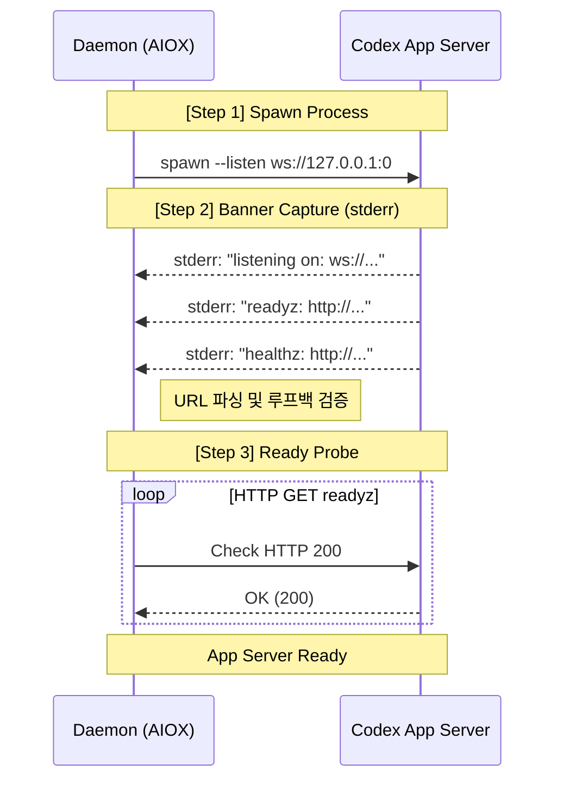
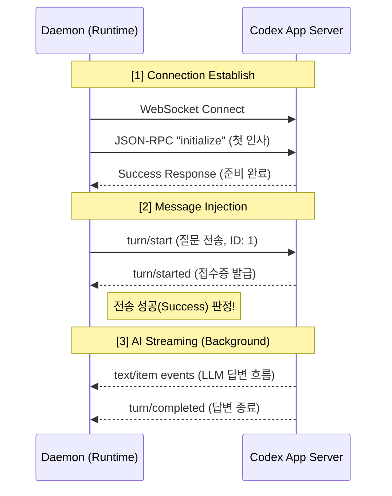

# Phase A Design Decisions: Codex Agent Runtime & TUI

> **STATUS (2026-05-21)**: This is a user-facing learning summary, not the
> Phase A authority document. The authoritative Step 10 Phase A decision record
> is `history/33-step-10-phase-a-decisions.history.md`. In particular, D7 is
> **id replacement on authoritative returned id**: history/27/32 verified
> returned Codex thread/session ids so aiox can replace the paired agent's
> previous binding when authority conditions hold. Do not read this document as
> "observe rebind signals but ignore them" or as blanket "no auto rebind".

본 문서는 `Step 10 Phase A`에서 결정된 Codex 에이전트의 런타임 모델, 프로세스 관리, 그리고 통신(Injection) 매커니즘에 대한 설계 원칙을 정리합니다.

## 1. 개요 (Overview)

AIOX의 Codex 에이전트는 **"에이전트별 독립된 앱 서버"** 모델을 채택합니다. 이는 각 에이전트가 자신만의 `codex app-server` 인스턴스를 가지며, CLI와 데몬이 각각의 역할을 나누어 관리하는 구조입니다.

---

## 2. Decision 2: App Server Launch & Banner Parsing

앱 서버의 기동은 데몬이 담당하며, 서버가 내보내는 배너 정보를 통해 통신 엔드포인트를 확보합니다.

### 핵심 원칙
- **배너 출력 채널:** 배너 정보는 `stdout`이 아닌 `stderr`로 출력됨을 확인.
- **파싱 전략:** 정규식에 의존하기보다 데이터 누적(Buffer) → ANSI 제거 → 줄바꿈 정규화 → URL 파서 검증 순의 파이프라인 구축.
- **준비 확인 (Ready Signal):** 배너에 포함된 `readyz` URL을 대상으로 HTTP GET 200 응답이 올 때까지 폴링(Polling).
- **스트림 관리 (Drain):** `stdout`과 `stderr`를 각각 독립된 **Ring Buffer**로 지속적으로 읽어내어 프로세스 Hang 방지.

### 실행 흐름 (Launch Sequence)



---

## 3. Decision 3: TUI Launch & Process Ownership

사용자에게 보여지는 TUI 화면은 CLI 프로세스가 직접 관리하며, 데몬과는 RPC를 통해 협력합니다.

### 핵심 원칙
- **프로세스 소유권 분리:** 
    - **Daemon:** `app-server`를 소유. (백그라운드 서비스)
    - **CLI:** `codex TUI`를 소유. (포그라운드 사용자 화면)
- **입출력 상속 (`stdio: "inherit"`):** CLI가 TUI를 실행할 때 터미널의 제어권(키보드/화면)을 직접 넘겨주어 부드러운 사용자 경험 보장.
- **원자적 실패 처리 (Launch Failure Atomicity):** TUI 실행 자체가 실패(파일 없음 등)할 경우, 이미 띄워진 데몬 측의 `app-server`도 즉시 종료(Rollback)하여 좀비 프로세스 방지.

### 프로세스 및 통신 모델

```text
┌─────────────────────────────────────┐         ┌─────────────────────────────────────┐
│   OS Process 2: 사용자 화면 (CLI)   │         │  OS Process 1: 백그라운드 (Daemon)  │
│         [ aiox codex CLI ]          │         │              [ Daemon ]             │
└──────────────────┬──────────────────┘         └──────────────────┬──────────────────┘
                   │                                               │
                   │ 1. RPC 요청: Request Attach                   │
                   ├──────────────────────────────────────────────▶│
                   │                                               ├─ spawn ─▶ [ app-server ]
                   │                                               │
                   │ 2. RPC 응답: Return WS URL                    │
                   │◀──────────────────────────────────────────────┤
                   │
  ┌────────────────▼────────────────┐
  │ spawn ─▶ [ codex TUI ]          │
  │ 옵션   : stdio "inherit"        │
  │ 상태 보관: Local TUI Handle     │
  └────────────────┬────────────────┘
                   │
       [만약 TUI 실행 실패 시]
                   │
                   │ 3. RPC 요청: Startup Rollback                  │
                   └─ ─ ─ ─ ─ ─ ─ ─ ─ ─ ─ ─ ─ ─ ─ ─ ─ ─ ─ ─ ─ ─ ─ ▶│
                                                                   └─ Kill app-server
```

---

## 4. Decision 4: WebSocket Injector & Handshake

에이전트 간의 메시지 전달을 위한 웹소켓 통신 규칙을 정의합니다.

### 핵심 원칙
- **웹소켓 소유권:** 각 에이전트의 런타임(`CodexAgentRuntime`)이 전용 웹소켓 클라이언트를 상주(Persistent) 시킴.
- **초기 핸드셰이크 (D4.7):** 웹소켓 연결 직후, JSON-RPC `initialize` 요청을 통해 기계적인 통신 준비 상태를 반드시 확인.
- **메시지 번호표:** 숫자로 된 순차적 번호(Monotonic Counter) 사용.
- **성공 판정 기준 (Response Semantic):** AI의 최종 답변 완료가 아닌, **"서버의 메시지 접수 확인(`turn/started`)"** 시점에 전송 성공으로 판정하여 지연 시간 최소화.

### 통신 상세 흐름



---

## 5. 설계의 안정성 요약

- **Fail-fast:** 준비가 안 된 상태에서 추측하여 실행하지 않고 즉시 에러를 발생시킴.
- **Hang 방지:** 스트림 드레인을 통해 버퍼 꽉 참으로 인한 프로세스 멈춤 현상 원천 차단.
- **리소스 정리:** 어떤 단계에서든 실패 시 연관된 모든 프로세스를 함께 정리하는 롤백 매커니즘 적용.
