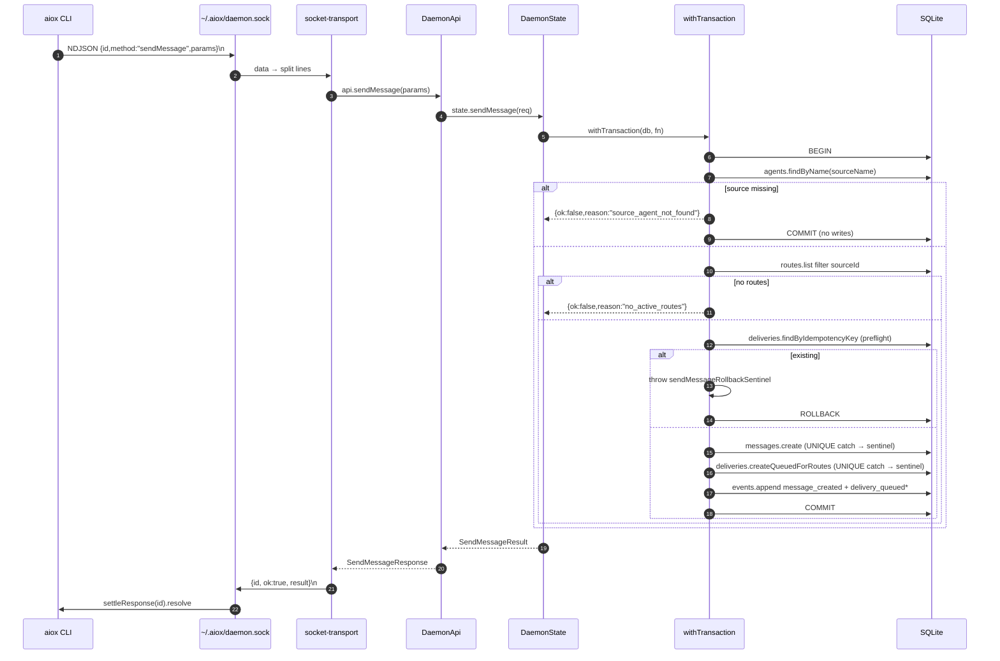
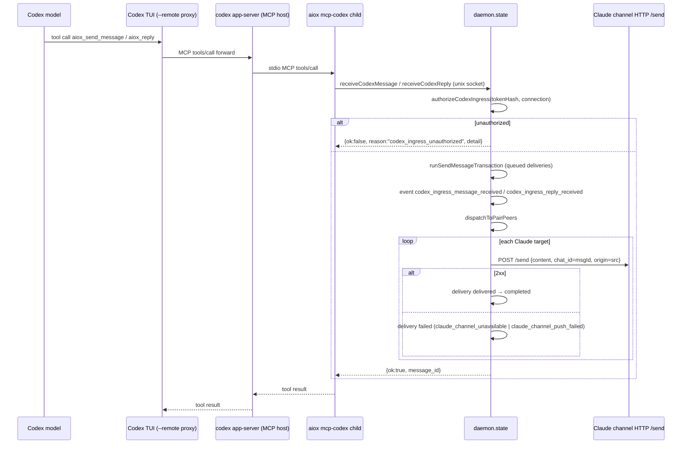
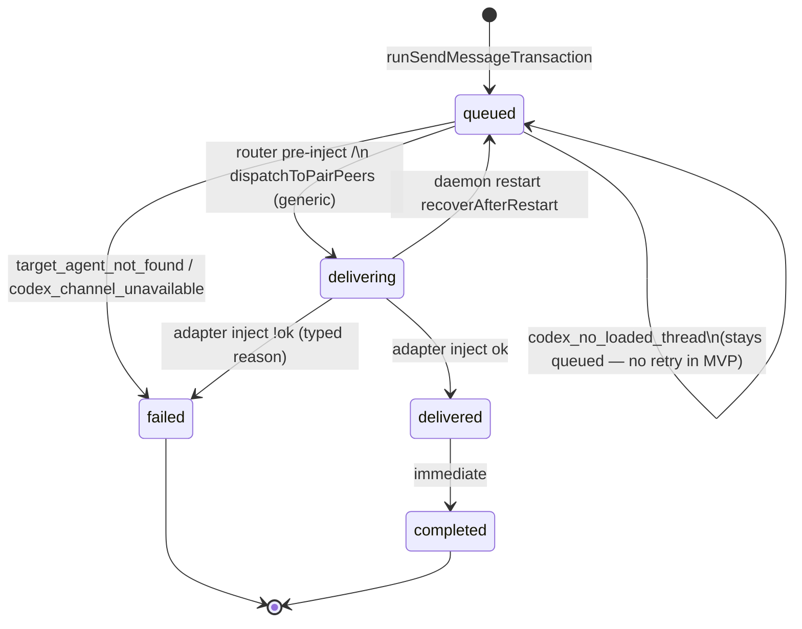

# aiox MVP — As-Built Architecture

> Date: 2026-05-26
> Status: MVP implementation closed (history/42); promoted to as-built
> architecture authority on 2026-06-16.
> Role: this is the `docs/architecture` authority for the current aiox MVP
> internal structure, responsibility boundaries, data flow, and lifecycle
> invariants.
> Product/spec intent lives in `docs/product/` and `docs/specs/`; the former
> MVP PRD is absorbed/deleted during workspace reset and is not primary
> authority. `prd/pre-validation/*` is W5 evidence candidate material, not
> current architecture authority. Decision rationale
> cited here remains historical evidence until W5 migration. When this document
> conflicts with code or authority docs, update this document.
>
> Every concrete claim cites either `file:line` or `history/<N>`. Where a
> behavior exists in code but has no recorded rationale, it is marked
> **Implementation-only (no recorded rationale)** — the description is factual,
> not inferred.

---

## 0. Purpose

aiox is a local AI agent orchestration tool. The MVP wires one Claude CLI
session and one Codex CLI session into a pair so each can send/reply to the
other through a local daemon. This document is the entry point for
debugging, onboarding, and verifying behavior. It covers:

- Process topology
- SQLite schema and repositories
- Daemon API surface and socket transport
- Claude adapter (channel-server / launcher / injector / ingress RPCs)
- Codex adapter (per-agent app-server + per-agent transparent proxy + TUI +
  MCP ingress + injector + `--resume`)
- Cross-cutting message routing (sendMessage idempotency, router, delivery
  state machine, queued fallback, `parent_message_id`)
- CLI surface + invocation layer + doctor/status
- Consolidated catalogs of typed errors and events
- Lifecycle invariant
- Implementation smoke matrix
- Known gaps / Post-MVP

---

## 1. Process Topology

Per running pair the OS sees the following processes:

```
┌───────────────────────────────────────────────────────────────────────────┐
│                                                                           │
│   ┌─────────────────────────────┐         ┌──────────────────────────┐    │
│   │  aiox daemon (in-mem SQLite)│         │  aiox CLI (per command)  │    │
│   │                             │         │                          │    │
│   │  socket: ~/.aiox/daemon.sock│◀───UDS──│  createClientRuntime     │    │
│   │  state.ts / api.ts          │         │  invocation.ts           │    │
│   │  codexRuntimes Map          │         └─────────────┬────────────┘    │
│   │  claudeChannelRuntimes Map  │                       │                 │
│   │  codexChannelRuntimes Map   │                       │ spawn (inherit) │
│   └──────┬──────────────────────┘                       ▼                 │
│          │                                  ┌────────────────────────┐    │
│          │ owns per Codex agent             │  codex --remote <proxy>│    │
│          ▼                                  │  (foreground TUI)      │    │
│   ┌──────────────────┐  WS ┌───────────┐    └───────────┬────────────┘    │
│   │  per-agent proxy │◀───▶│ app-server│◀──────────WS───┘                 │
│   │  (in daemon proc │     │ child proc│                                  │
│   │   :0 WS server)  │     │  --listen │                                  │
│   └──────────────────┘     │  ws://:0  │ spawns MCP host child            │
│          ▲                 └─────┬─────┘                                  │
│          │ daemon                │ -c mcp_servers.aiox = {...}            │
│          │ JSON-RPC              ▼                                        │
│          │              ┌──────────────────────┐                          │
│          │              │  aiox mcp-codex      │                          │
│          │              │  (stdio MCP child)   │                          │
│          │              └──────────┬───────────┘                          │
│          │                         │ unix socket                          │
│          │                         ▼                                      │
│          │                  daemon.receiveCodex*                          │
│          │                                                                │
│          │  per Claude agent                                              │
│          │  ┌─────────────────────────┐                                   │
│          │  │  claude CLI             │                                   │
│          │  │   ↓ spawns via --mcp-cfg│                                   │
│          │  │  channel-server (stdio) │                                   │
│          │  │  HTTP /send 127.0.0.1:0 │◀── daemon HTTP POST (inject)      │
│          │  └─────────────────────────┘                                   │
│          │                                                                │
└──────────┴────────────────────────────────────────────────────────────────┘
```

**Per-agent counts**

- Codex agent → 1 app-server child (daemon-owned) + 1 proxy WS server
  (in-process in daemon) + 1 TUI child (CLI-owned, `stdio:"inherit"`) + 1
  `aiox mcp-codex` stdio child (app-server-owned via Codex MCP host).
- Claude agent → 1 `claude` child (CLI-owned, foreground) + 1 channel-server
  stdio child (Claude-owned via launcher-injected `--mcp-config`).

**MVP invariant** (Round 3 D5-A.5, history/34:623-630)
`Daemon manages exactly one direct child per Codex agent: the app-server.
Cleanup is WS close → SIGTERM → 3s grace → SIGKILL. No process group kill,
no setsid, no PR_SET_PDEATHSIG, no periodic healthz, no auto-reconnect, no
TUI heartbeat. TUI lifecycle is owned by the CLI process scope.`

Authority context: history/29 (per-agent app-server pivot),
history/31 (production direction), history/34 Round 3, history/42 (closeout).

---

## 2. SQLite Schema

In-memory only — `runDaemonProcess` opens `new Database(":memory:")`
(`src/daemon/run.ts:25`). The file-mode helper `openSqliteDatabase`
(`src/store/sqlite.ts:5-12`) is unused. `applySchema` is idempotent
`create table if not exists` (`src/store/schema.ts:3-68`).

| Table | Key columns | Notes |
|---|---|---|
| `agents` | `id PK`, `name UNIQUE NOT NULL`, `kind`, `status`, `cwd`, `pair_id`, `adapter_session_id`, timestamps | `adapter_session_id` holds Codex active thread id (nullable). `pair_id` no FK. |
| `pairs` | `id PK`, `name UNIQUE NOT NULL`, `status` (`pending`/`ready`) | |
| `routes` | `id PK`, `source_agent_id`, `target_agent_id`, `status`, `UNIQUE(source,target)` | Directed. No FK. |
| `messages` | `id PK`, `source_agent_id`, `parent_message_id` (nullable), `type`, `content`, timestamps | Type ∈ `question|instruction|status|event|reply`. |
| `message_deliveries` | `id PK`, `message_id`, `target_agent_id`, `route_id`, `status`, `idempotency_key UNIQUE NOT NULL` | UNIQUE constraint is load-bearing for the rollback-sentinel reclassify pattern. |
| `events` | `id PK`, `agent_id`/`message_id`/`delivery_id`/`route_id` (all nullable), `type`, `data_json`, `created_at` | Append-only. |

`recoverAfterRestart` exists on `DeliveryRepository`
(`src/store/repositories/deliveries.ts:148-158`) and resets
`delivering → queued`, but has **no caller** in `src/`
— Implementation-only (no recorded rationale for non-wiring; daemon DB is
in-memory so there is nothing to recover anyway).

---

## 3. Repositories

All under `src/store/repositories/`. Snake-case rows mapped to camelCase
domain objects. Transactional boundaries are owned by callers in
`src/daemon/state.ts`, wrapped through
`src/store/transaction.ts:3-5` (`withTransaction = db.transaction(fn)()`).

| Repo | Key methods | Key transactional logic |
|---|---|---|
| `agents` | `attach`, `findByName`, `list`, `markByNameDisconnected`, `markAllConnectedDisconnected`, `rebindAdapterSessionId` | `attach` upsert; rejects with `agent_name_already_connected` if existing row is `connected`. No internal tx. |
| `pairs` | `createReservation`, `attachAgent` | `attachAgent` runs in own `db.transaction` (`pairs.ts:71-154`): verifies agent, checks `kind`, ensures kind-slot free, updates `pair_id`, recomputes `status = "ready"` when both kinds present. |
| `routes` | `create`, `disconnect`, `findBySourceAndTarget`, `list` | `create` returns typed `route_already_exists`; `disconnect` collects rows then deletes in a tx. |
| `messages` | `create`, `count`, `list` | Plain inserts; no tx. |
| `deliveries` | `createQueuedForRoutes`, `updateStatus`, `findByIdempotencyKey`, `countByStatus`, `recoverAfterRestart` | `createQueuedForRoutes` inserts all rows in one `db.transaction`. UNIQUE collision on `idempotency_key` is caught and reclassified to typed `delivery_idempotency_key_exists` with the existing row attached (`deliveries.ts:117, 215-222`). |
| `events` | `append`, `list` | Append-only. |

**Rollback sentinel pattern** (history/23 D2, history/25 D5):
two module-local `Symbol`s in `src/daemon/state.ts:35-36`:

- `attachRollbackSentinel` — used by `attachAgent` so
  `pair_slot_occupied` / `pair_full` / `agent_kind_mismatch` can throw out
  of `withTransaction` cleanly. Reclassified at the outer catch via
  `isAttachRollback`.
- `sendMessageRollbackSentinel` — used by `runSendMessageTransaction` to
  unwind on `delivery_idempotency_key_exists` (both the in-tx preflight and
  the UNIQUE-catch path).

The symbols are module-private to ensure unrelated callers cannot fabricate
the rollback token.

---

## 4. Daemon Lifecycle and Socket Transport

### 4.1 Daemon Lifecycle

`aiox _run-daemon --socket <path>` is the hidden long-running entry point
(`src/cli/parse.ts:315-321`; dispatched in `src/cli/invocation.ts:211-215`).
`runDaemonProcess` (`src/daemon/run.ts:24-87`):

1. Opens in-memory SQLite, applies schema.
2. Builds the server with `createDaemonServer`, threading the production
   `attachCodexRuntime`.
3. Wraps the `stop` RPC so the daemon schedules `shutdown()` on
   `setImmediate` after responding to the client (`run.ts:66-73`).
4. Registers once-shot SIGTERM/SIGINT handlers (`run.ts:83-84`).

`shutdown()` (`run.ts:47-61`) closes the socket server, marks all
connected agents disconnected (`stop({})`), and `db.close()`s.

**Socket path resolution** (`src/config/paths.ts:9-17`):
`$AIOX_SOCKET_PATH` if set, else `~/.aiox/daemon.sock` (`mkdir -p` parent).

**Auto-start** is wired only on the `agent-attach` branch
(`src/cli/invocation.ts:108-111`). `aiox daemon start` and all other
commands either start explicitly or are connect-only and will fail if the
daemon is absent. See command table in §10.

### 4.2 Socket Transport

`src/daemon/socket-transport.ts`. Authority: history/25, history/26.

| Property | Value | Cite |
|---|---|---|
| Transport | Unix Domain Socket (`net.createServer`) | history/25 D1; `socket-transport.ts:60` |
| Framing | NDJSON; `\n`-terminated lines, partial-line buffer both sides | history/25 D2; `socket-transport.ts:64-69, 299-303` |
| Request envelope | `{ id, method, params? }` | `socket-transport.ts:27-31` |
| Response envelope | `{ id, ok:true, result }` or `{ id, ok:false, error: { reason, message } }` | `socket-transport.ts:33-46` |
| Client topology | Single persistent socket per `createDaemonSocketClient`; per-request id multiplex via `Map<id, PendingRequest>` | history/26 H1; `socket-transport.ts:262-392` |
| Request timeout | `requestTimeoutMs` default 30 s | history/26 H2; `socket-transport.ts:266, 370-374` |
| Stale-path retry | Listen-first; on EADDRINUSE, probe `canConnect`; if live → fail; else `unlink` + single retry | history/26 H3; `socket-transport.ts:394-424` |
| Transport vs daemon API errors | Transport envelope `error.reason ∈ {invalid_json, invalid_envelope, unknown_method, internal_error}`; daemon API typed errors return as `ok:true, result:{ok:false, reason}` at the envelope layer | history/25 D6; `socket-transport.ts:155-218` |

**Implementation-only behaviors**: the `setImmediate(shutdown)` ordering in
`run.ts:66-73` and the fact that `recordCodexRuntimeFailed` exists on
`DaemonState` but is omitted from `DaemonApi` (so it is not callable over
the socket — only via in-process state references).

### 4.3 sendMessage end-to-end (sequence)



---

## 5. Daemon API Surface

All RPCs are declared at `src/daemon/api.ts:49-87`; state implementations in
`src/daemon/state.ts:471-1133`. Daemon API typed errors never throw at the
transport — they are returned as `{ ok:false, reason }` results.

| Method | Mutates | Emits | Typed errors | Cite |
|---|---|---|---|---|
| `attachAgent` | agents upsert; pairs.attachAgent; routes bidirectional if pair ready; in-memory `codexRuntimes` / pending tokens | `agent_thread_id_rebound` on resume | `agent_name_already_connected`, `pair_not_found`, `pair_slot_occupied`, `pair_full`, `agent_kind_mismatch`, `codex_resume_failed`, `codex_runtime_attach_failed` | state.ts:493-702 |
| `createPair` | pairs insert | — | `pair_name_already_exists` | state.ts:704-721 |
| `connect` | routes insert in tx | — | `source_agent_not_found`, `target_agent_not_found` | state.ts:723-763 |
| `disconnect` | routes delete in tx | — | `source_agent_not_found`, `target_agent_not_found` | state.ts:765-779 |
| `sendMessage` | messages + deliveries + events (single tx) | `message_created`, `delivery_queued` | `source_agent_not_found`, `no_active_routes`, `delivery_idempotency_key_exists` | state.ts:1639-1741 |
| `updateDeliveryStatus` | deliveries.updateStatus + events | `delivery_status_changed` | `delivery_not_found` | state.ts:1135-1187 |
| `rollbackAgentAttach` | disposes in-flight codex runtime; removes pending token; marks agent disconnected | — | none typed (`{ok:true,rolledBack}`) | state.ts:789-823 |
| `detachAgent` | dispose codex runtime + clear channel maps; mark disconnected | `agent_graceful_detach` (trigger=`explicit_detach`) | none | state.ts:825-830 + 1743-1795 |
| `notifyTuiExited` | same as detachAgent cleanup | `agent_graceful_detach` (trigger=`tui_exit`) | none | state.ts:832-839 |
| `registerClaudeChannel` | consumes pending token; inserts `claudeChannelRuntimes` | — | `claude_channel_registration_failed` (`unknown_token`/`invalid_endpoint`) | state.ts:883-911 |
| `disconnectClaudeChannel` | removes runtime | — | none | state.ts:913-917 |
| `receiveClaudeChannelMessage` | runSendMessageTransaction (type=`question`) + dispatch to codex | `claude_channel_message_received` + sendMessage events + dispatch events | sendMessage typed errors | state.ts:919-950 |
| `receiveClaudeChannelReply` | sendMessage (type=`reply`, parent=chatId) + dispatch | `claude_channel_reply_received` + downstream | always returns `{ok:true}` to channel-server | state.ts:952-985 |
| `registerCodexChannel` | consumes pending token; inserts `codexChannelRuntimes` | `codex_channel_registered` | `codex_channel_registration_failed` (`unknown_token`) | state.ts:987-1017 |
| `disconnectCodexChannel` | removes runtime + pending token | `codex_channel_disconnected` (if had runtime) | none | state.ts:1019-1037 |
| `receiveCodexMessage` | authz + sendMessage(`question`) + dispatch to claude | `codex_ingress_message_received` + downstream | `codex_ingress_unauthorized` + sendMessage errors | state.ts:1039-1068 |
| `receiveCodexReply` | authz + sendMessage(`reply`, parent=`parentMessageId`) + dispatch | `codex_ingress_reply_received` + downstream | same as above | state.ts:1070-1103 |
| `status` | none | none | none | state.ts:1105-1117 |
| `stop` | `markAllConnectedDisconnected` unless `daemonOnly`; clears channel maps | — | none | state.ts:1119-1132 |

---

## 6. Claude Adapter

### 6.1 Topology

Per Claude agent: 1 Claude CLI process + 1 channel-server stdio child
(spawned by Claude itself; the dev-channel `server:"aiox-claude-ingress"`
resolves the MCP that the launcher injects one-off via `--mcp-config`, key
hard-coded at `src/cli/invocation.ts:155`, history/49) + 1 loopback HTTP
`/send` ingress on 127.0.0.1.

Channel-server is **not** a daemon child. The daemon only stores an
in-memory pointer (`claudeChannelRuntimes` Map at `state.ts:482-483`); no DB
row. Rationale: history/35 D2 Option A (DB-only + daemon memory registry).

### 6.2 Launch Flow (`aiox claude --name <n>`)

1. Parser registers `--name` and `--pair`. `--resume` is option-scoped to
   the codex subcommand, so commander rejects `--resume` on `claude` at
   parse stage (`src/cli/parse.ts:229-231`, history/34:1002-1005, S5 smoke
   PASS).
2. CLI auto-starts daemon, calls `attachAgent({kind:"claude", name, ...})`.
3. Daemon mints a `randomUUID()` claude channel token, stores it in
   `claudePendingTokens[agentName]`, returns it as `claudeChannelToken`
   (`state.ts:567-574`).
4. CLI calls `launchClaudeWithChannel({channelName:"aiox-claude-ingress",
   agentName, agentToken, daemonSocketPath})` (`src/cli/invocation.ts:144-170`,
   `src/adapters/claude/launcher.ts`). The launcher appends `--mcp-config` with
   an inline aiox channel server definition (`buildClaudeChannelMcpConfig`):
   `command` = node, `args` = absolute `channel-server.js` (resolved from
   `import.meta.url`, no cwd/`.mcp.json` coupling), `env` =
   `AIOX_CLAUDE_CHANNEL_AGENT_NAME` / `AIOX_CLAUDE_CHANNEL_TOKEN` /
   `AIOX_SOCKET_PATH`.
5. Claude resolves `server:"aiox-claude-ingress"` against the injected
   `--mcp-config` and spawns the channel-server stdio child with that `env`.
6. channel-server (`src/adapters/claude/channel-server.ts:378-410`):
   - `parseChannelServerEnv` fatal-exits if any required env is missing
     (`missing_env_*`, `channel-server.ts:461-473`).
   - Creates an `McpServer` with capability `experimental:
     {"claude/channel":{}}` and `instructions: V1_INSTRUCTIONS`
     (`channel-server.ts:85-121`).
   - Registers MCP tools `send(text)` and `reply(chat_id, text)`
     (`channel-server.ts:123-146`).
   - Starts HTTP ingress on 127.0.0.1:0 (or
     `AIOX_CLAUDE_CHANNEL_PORT`).
   - Calls `daemon.registerClaudeChannel({agentName, token, endpoint})`
     (`channel-server.ts:320-354`).
7. Daemon validates the pending token and the endpoint
   (`parseLoopbackHttpEndpoint`: must be `http:` on loopback, path `/send`,
   non-empty port). On failure → `claude_channel_registration_failed` with
   `detail: "unknown_token"` or `"invalid_endpoint"`. Channel-server
   `process.exit(1)` on registration failure (`channel-server.ts:342`).
8. CLI awaits Claude exit then calls
   `disconnectClaudeChannel({agentName})`. Unlike Codex, no
   `claude_channel_disconnected` event is appended — Implementation-only
   (no recorded rationale).

### 6.3 Claude → daemon Ingress (tool calls)

Both `send` and `reply` tool handlers (`channel-server.ts:151-230`) create a
fresh `createDaemonSocketClient` per call and `close()` it `finally`.

- `send(text)` → `daemon.receiveClaudeChannelMessage({agentName, messageId,
  text})` → `runSendMessageTransaction({type:"question"})` → dispatch to
  Codex channels.
- `reply(chat_id, text)` →
  `daemon.receiveClaudeChannelReply({agentName, chatId, text})` →
  `runSendMessageTransaction({type:"reply", parentMessageId: chatId})`.
  **`chat_id` is persisted as `parent_message_id`** (state.ts:957,
  history/40:563).
- Tool errors map to MCP `isError:true` results with `daemon_call_failed`
  or the propagated daemon `reason` string
  (`channel-server.ts:170, 187, 225, 243-248`).

### 6.4 daemon → Claude Injection

`dispatchToPairPeers` (`state.ts:1246`) is fired by both Codex and Claude
ingress paths. For each delivery whose target is a Claude agent:

1. Transition delivery to `delivering`.
2. Call `injectClaudeChannel(lookup, {agentName, content, chatId:
   message.id, origin: sourceName})` (`src/adapters/claude/injector.ts:21-78`).
   `chat_id` is the **aiox message id**, `origin` is the **source agent
   name** (state.ts:1404-1406, history/40:563).
3. Injector resolves the runtime; absent → `claude_channel_unavailable`.
   `fetch(endpoint, POST, body)` with `AbortController` 5 s timeout.
   Non-2xx or timeout → `claude_channel_push_failed`. Other fetch error →
   `claude_channel_unavailable`.
4. HTTP ingress (`channel-server.ts:269-294`) validates with `InboundMessage`
   zod schema, builds `<channel source="aiox" chat_id="..." origin="...">…
   </channel>` envelope, and pushes via MCP notification
   (`notifications/claude/channel`). Responds `202` ok / `400` parse error /
   `404` wrong method or path.
5. On success: `delivered → completed`. On failure: `failed` with typed
   reason.

V1 trusted framing (history/35 D1) is enforced by `buildChannelNotification`
(`channel-server.ts:39-59`) and the MCP `instructions` string at lines
85-88, not by per-message confirmation.

### 6.5 Sequence — Claude reply → daemon → Codex

```mermaid
sequenceDiagram
    participant Cl as Claude (LLM)
    participant CS as channel-server (stdio MCP child)
    participant D as daemon (state.ts)
    participant CR as Codex runtime (per-agent)

    Note over Cl: receives <channel chat_id="M1" origin="codex-1">…
    Cl->>CS: MCP tool reply(chat_id="M1", text=…)
    CS->>D: socket.receiveClaudeChannelReply{agentName, chatId:"M1", text}
    D->>D: runSendMessageTransaction{type:reply, parentMessageId:"M1"}
    D->>D: events.append claude_channel_reply_received
    D->>D: dispatchToPairPeers(message, deliveries)
    loop each codex delivery
      D->>CR: resolveCodexReplyTarget(thread/loaded/list, activeThreadId)
      alt no_loaded_thread
        D->>D: events: codex_delivery_target_unavailable + queued_no_loaded_thread
        Note over D: delivery stays queued (MVP — no retry)
      else
        D->>D: event codex_delivery_target_selected; status=delivering
        D->>CR: injectReplyIntoCodexRuntime(threadId, <aiox-channel> envelope)
        alt ok
          D->>CR: rebindActiveThread
          D->>D: optional agents.rebindAdapterSessionId + agent_thread_id_rebound
          D->>D: status delivered → completed
        else
          D->>D: event codex_delivery_target_injection_failed; status=failed
        end
      end
    end
    D-->>CS: {ok:true}
    CS-->>Cl: tool result {ok:true}
```

---

## 7. Codex Adapter

This is the largest surface in the project.

### 7.1 Per-agent Runtime

Held in `CodexAgentRuntime` (`src/adapters/codex/runtime.ts:109-302`). Per
Codex agent: 1 daemon-owned app-server child + 1 daemon-owned per-agent
transparent proxy (in-process `WebSocketServer`) + 1 CLI-owned TUI child +
1 app-server-owned MCP child.

Daemon JSON-RPC writes go **directly** to the app-server (bypassing the
proxy) via the runtime's persistent WS client; the proxy URL is what the
TUI consumes (`runtime.ts:142-148, 259`).

Rationale: history/29 (pivot), history/31 (production direction).

### 7.2 Attach Flow (`aiox codex --name <n>`)

1. CLI parser registers `--name`, `--pair`, and codex-only `--resume`
   (`src/cli/parse.ts:218-249`).
2. `agent-attach` auto-starts daemon, calls `attachAgent` RPC
   (`src/cli/invocation.ts:108-121`).
3. Daemon `attachAgent` (`state.ts:493-702`) wraps DB attach + pair attach
   + route creation in a single `withTransaction`. For Codex, it pre-issues
   `codexChannelToken = randomUUID()` and stores it in `codexPendingTokens`
   (`state.ts:582-587`). Token is used by the MCP child handshake.
4. Daemon calls `attachCodexRuntime` (`state.ts:588-595`) →
   `attachCodexAgentRuntime` (`runtime.ts:304-366`):
   a. `launchCodexAppServer` spawns `codex app-server --listen
      ws://127.0.0.1:0` plus injected `-c mcp_servers.aiox = {...}` args
      (`launcher.ts:40-74, 88-104`).
   b. `parseCodexAppServerBanner` extracts URLs from stderr+stdout for
      `listening on:`, `readyz:`, `healthz:`. Endpoint must be `ws:` on
      loopback; readyz/healthz must be `http:`. Banner timeout 5 s
      (`app-server.ts:90-120`, history/34:79-95 stderr-first verification).
   c. `waitForCodexReadyz` polls every 200 ms up to 10 s, racing child-exit
      Promise (`app-server.ts:122-175`).
   d. `connectCodexAppServerWebSocket` opens persistent WS, 5 s connect
      timeout. Failure → typed `codex_app_server_ws_connect_failed`
      (`websocket.ts:288-347`).
   e. `client.initialize()` sends JSON-RPC `initialize` with
      `{clientInfo:{name:"aiox",version:<package.version>}, capabilities:
      {experimentalApi:false}}` (history/34:328-347 Round 2 decision;
      `runtime.ts:402-413` reads package.json). Failure → typed
      `codex_app_server_ws_initialize_failed`.
   f. `startCodexAgentProxy` opens an in-process WS server on
      `127.0.0.1:0` whose upstream is the app-server endpoint
      (`proxy.ts:58-149`, `runtime.ts:337-343`).
5. **Fresh attach skips daemon-side `thread/start`** (Step 14 follow-up,
   history/41:266-286). `adapter_session_id` stays null until explicit
   `--resume` or first live loaded-thread delivery.
6. Daemon returns `codexRuntime: { endpoint: proxy.url, activeThreadId:
   adapterSessionId }` (`state.ts:602-614`).
7. CLI spawns TUI with `launchCodexTui({endpoint, resumeSessionId?})`
   (`invocation.ts:122-129`, `launcher.ts:76-86`):
   - Fresh: `codex --remote <proxy-url>`
   - Resume: `codex resume <session-id> --remote <proxy-url>`
   - Stdio `"inherit"` (history/34 D3.4 — TUI is CLI-child).
8. CLI awaits TUI exit. On exit → `api.notifyTuiExited({agentName,
   exitCode, signal})`. On spawn error → `api.rollbackAgentAttach` then
   typed exit `aiox.invocation.tui_launch_failed`
   (`invocation.ts:130-142, 230-237`).

**Attach-failure cleanup ordering** (Round 2-fix F1, history/34:464-473):
WS connect / initialize failure unwinds in reverse — proxy → ws →
`disposeCodexAppServerOnAttachFailure(appServer)` (single SIGTERM, no
SIGKILL escalation, `app-server.ts:177-185`).

### 7.3 Resume Flow (`--resume <session-id>`)

Steps 1–4f are identical. Then:

- Daemon calls `runtime.resumeThread(sessionId)`
  (`state.ts:617`, `runtime.ts:224-240`) → JSON-RPC `thread/resume
  {threadId}` and asserts returned id equals requested id. Mismatch or
  missing throws typed `codex_resume_failed`.
- `agents.rebindAdapterSessionId({...})` persists the new id
  (`state.ts:636-647`).
- `agent_thread_id_rebound` event appended with `operation:"thread/resume",
  source:"attach_resume"` (`state.ts:651-665`).
- CLI launches `codex resume <session-id> --remote <proxy-url>`.

Failure handling cleans up `startingCodexRuntime`, deletes pending token,
marks agent disconnected, returns the typed reason
(`state.ts:676-701, 1929-1939`).

### 7.4 Transparent Proxy

File `src/adapters/codex/proxy.ts`. Authority: history/27 (transparent
relay decision), history/28 (lazy observation cost model), history/42
(production reintroduction).

**Relay obligation**: every WebSocket frame, both directions, passes
through unchanged. Binary frames preserved as-is; text frames normalized
only for inspection (`proxy.ts:225-239`). Frames received before upstream
`open` are queued (`proxy.ts:72, 78-81, 91`).

**Observation rule** (binding methods: `thread/start`, `thread/resume`,
`thread/fork` — `proxy.ts:46-50`):

- Client→server: `observeClientFrame` records `{requestId → method}` in a
  per-connection `pendingBindings` Map *after* the relay branch
  (`proxy.ts:151-166`).
- Server→client: `observeUpstreamFrame` consumes the matching entry on the
  response with the same `id` (`proxy.ts:168-194`). If `error` is present,
  no event fires. Otherwise extract `result.thread.id` and emit
  `CodexProxyBindingEvent{method, threadId, requestId}`.

**Lazy parse** (commit `edaf02b`, history/28 rule):
- Client side: `frameMayContainBindingMethod` does `indexOf` substring
  filter on the binding method names; binary frames return `false`
  (`proxy.ts:196-206`). Only survivors get `JSON.parse`d.
- Server side: early bail `if (pendingBindings.size === 0) return`
  (`proxy.ts:173-175`).
- The 4 KB size cutoff proposed in history/28:126-136 is **not**
  implemented — Implementation-only refinement.

The runtime subscribes to proxy binding events via `runtime.onProxyBinding`
(`state.ts:598-600`); the daemon-side handler `handleCodexProxyBinding`
(`state.ts:1511-1555`) rebinds `agents.adapterSessionId` in
`withTransaction` and appends `agent_thread_id_rebound` with
`operation:event.method, source:"proxy_binding"`.

### 7.5 Active-Thread Binding Authority

Three writer sources (in order):

1. **Daemon-originated `thread/resume`** during `--resume` attach
   (state.ts:636-665).
2. **Proxy-observed same-connection response** for
   `thread/start|resume|fork` (state.ts:1537-1552). Covers TUI-originated
   `/clear`, `/new`, `/fork`, and `/resume` when their JSON-RPC responses
   transit the proxy. Empty-thread `/fork` returns a JSON-RPC error so no
   rebind fires.
3. **Live `thread/loaded/list` fallback** at delivery time (see §8.5).

The earlier internal TUI `/resume` wrong-thread risk was resolved for MVP by
same-connection proxy observation and covered by implementation smoke
(history/41, history/42). This depends on Codex continuing to send
`thread/resume` responses for TUI `/resume` through the same proxied
connection.

Event types: `agent_thread_id_rebound` (3 emission sites);
`codex_binding_uncertain_observed` is declared in the union but has **no
production emitter** (`src/core/events.ts:15`; planned in history/34:435
but did not land — Implementation-only).

### 7.6 Injection (`turn/start`)

File `src/adapters/codex/injector.ts`. Ack semantic (Round 2 D4.4,
history/34:287-308): success = same-client JSON-RPC response received
with the runtime's `activeThreadId` still equal to the requested
`threadId`. Does **not** wait for `turn/started` or `turn/completed`.

- Pre-request guard: thread mismatch → `codex_binding_uncertain`
  (`injector.ts:26-32`).
- Request body: `{threadId, input:[{type:"text", text:<envelope>}]}` —
  Codex 0.132.0 schema requires array form (history/34:310-327).
- Post-ack guard: re-checks mismatch (`injector.ts:52-58`).
- Error mapping: typed codes pass through; unknown errors → generic
  `adapter_inject_failed`.

The daemon-side wrapper `injectReplyIntoCodexRuntime`
(`state.ts:1557-1575`) constructs a fresh `CodexTurnStartRuntime` view
with the freshly-resolved live thread id so the mismatch guard remains
meaningful without mutating the runtime cache pre-success.

### 7.7 Daemon → Codex Delivery (live loaded-thread + queued fallback)

Entry: `dispatchToPairPeers` (`state.ts:1246`).

1. `resolveCodexReplyTarget` (`state.ts:1433-1503`):
   - Runtime absent / not ready → `codex_channel_unavailable`.
   - `runtime.listLoadedThreadIds()` → `thread/loaded/list` JSON-RPC.
   - **Selection policy**:
     - If `runtime.activeThreadId` is set → policy
       `"proxy_active_thread"`.
     - Else `loadedThreadIds.at(-1)` → policy
       `"latest_loaded_thread_fallback"`. Latest-loaded chosen because the
       app-server returns the visible/current thread last
       (history/40:540-549).
     - Empty → `codex_no_loaded_thread`.
2. **No loaded thread**: emit `codex_delivery_target_unavailable` +
   `codex_delivery_queued_no_loaded_thread`. Delivery **stays queued** (no
   FSM transition; no retry in MVP — history/40:506-518).
3. **Live target**: emit `codex_delivery_target_selected`, transition
   `queued → delivering`, call `injectReplyIntoCodexRuntime` with
   `formatCodexAioxChannelEnvelope(message, sourceAgent?.kind ?? "unknown")`:
   `<aiox-channel source="<sender-agent-kind>" message_id="...">CONTENT</aiox-channel>`
   (state.ts:1699).
4. On success: `runtime.rebindActiveThread(targetThreadId)`. If chosen
   thread ≠ `agent.adapter_session_id`, persist and emit
   `agent_thread_id_rebound` with `operation:"thread/loaded/list",
   source:"loaded_list"`. Transition `delivered → completed`.
5. On failure: emit `codex_delivery_target_injection_failed`; delivery
   `failed`.

### 7.8 Codex MCP Ingress (Codex → daemon)

File `src/adapters/codex/mcp-server.ts`. History/39 records the Step 13
ingress.

**Tools**:
- `aiox_send_message({content})` → daemon `receiveCodexMessage`.
- `aiox_reply({parent_message_id, content})` → daemon `receiveCodexReply`.

**Launcher injection** (`launcher.ts:88-120`):
`-c mcp_servers.aiox = { command=<process.execPath>, args=[<aioxBin>,
"mcp-codex"], env={AIOX_CODEX_AGENT_NAME, AIOX_CODEX_AGENT_TOKEN,
AIOX_SOCKET_PATH} }`. Injected into the **daemon-owned app-server**, not
into the foreground TUI (Step 14 follow-up history/40:288-310 — earlier
Step 13 injected into the TUI which in `--remote` mode is not the MCP
host, so the aiox MCP never registered).

**Token handshake**:
1. Daemon pre-issues `codexChannelToken = randomUUID()` and stores it in
   `codexPendingTokens` (state.ts:582-587).
2. Token + agent name + socket path are env-passed through to the MCP
   child.
3. MCP child does `mcp.connect()` first, then `registerCodexChannel`
   (history/40:280-310 — protocol contract honored before failure paths).
4. Daemon consumes the pending token, stores `tokenHash =
   sha256(token)` in `codexChannelRuntimes` (full SHA-256, not 12-char
   prefix — history/39:225-232), appends `codex_channel_registered`.
5. Every subsequent tool call calls `authorizeCodexIngress` (state.ts:1589-1637)
   which checks token presence, agent registration, connection status, and
   token hash equality. Reasons: `codex_ingress_unauthorized` with `detail
   ∈ {missing_token, agent_not_registered, agent_disconnected,
   token_mismatch}`.

### 7.9 Lifecycle and Ownership

**Ownership model** (Critical Issue 4-1 Option A, history/34:745-817, memory
`aiox-codex-attach-ownership`): `attachAgent` is the Codex runtime
lifecycle owner. The daemon is the only owner of the app-server child; the
daemon owns same-client JSON-RPC authority; the CLI is the sole parent of
the TUI child. Claude attach is DB-only.

**Dispose ordering** (`runtime.dispose()`, `runtime.ts:193-209`):
1. `webSocket.close()`
2. Best-effort fire-and-forget `closeProxyBestEffort` (proxy close runs
   before SIGTERM yields the event loop — Implementation-only ordering
   note at `runtime.ts:204-205`).
3. `await disposeAppServer(appServer)` → SIGTERM → 3 s grace → SIGKILL
   (`app-server.ts:187-219`).

**Listen-only observers** (`runtime.ts:264-286`):
- `appServer.child.exit` → `recordRuntimeFailure({type:"app_server_process_exited"})`
- `webSocket.onClose` → `recordRuntimeFailure({type:"ws_dropped"})`
- `webSocket.onNotification` for `remoteControl/status/changed` →
  stored as `latestDiagnosticNotification` (D7 authority disclaimer in
  history/34:570-595 — diagnostic context only, not binding authority).

Runtime-failure callback flows up to `recordCodexRuntimeFailed`
(state.ts:841-881), appending `agent_runtime_failed`.

### 7.10 Sequence — Codex MCP → daemon → Claude



---

## 8. Cross-Cutting Message Routing

### 8.1 Domain Model

- **Message**: `src/core/messages.ts:17-23`; type ∈
  `question|instruction|status|event|reply`.
- **Delivery**: `src/core/deliveries.ts:13-19`. Idempotency key formatted
  `${messageId}:${targetAgentId}` (line 34). Status ∈
  `queued|delivering|delivered|completed|failed` (lines 3-9).
- **Pair**: `src/core/pairs.ts`. Reaches `ready` when both slots (`a` and
  `b`) are filled (`attachments.length === 2 && slots.has("a") && slots.has("b")`
  — `pairs.ts:107-117`). Slot assignment is auto-selected at attach time; no
  vendor is hardwired to a specific slot.
- **Route**: directed `(source, target)`. Fan-out filters
  `sourceAgentId === source.id`.

### 8.2 sendMessage Atomicity + Idempotency

`runSendMessageTransaction` (`state.ts:1639-1741`) is wrapped in a single
`withTransaction`. Sequence:

1. `agents.findByName(sourceName)` → `source_agent_not_found`.
2. `routes.list().filter(sourceId)` → empty → `no_active_routes` (β-1
   atomic reject — history/20 §3:107-152). **No** message/delivery/event
   rows are written on this path.
3. Idempotency preflight: `deliveries.findByIdempotencyKey` per route. Hit
   → throw `sendMessageRollbackSentinel` carrying
   `{reason:"delivery_idempotency_key_exists", existing}` (history/25 D4
   moved preflight inside the tx).
4. `createMessageOrRollback` and `deliveries.createQueuedForRoutes` —
   `SQLITE_CONSTRAINT_UNIQUE` is caught and reclassified through the same
   sentinel (history/25 D4 dual gate).
5. Append `message_created` event + one `delivery_queued` per delivery.
6. Outer catch unwraps the sentinel via `isSendMessageRollback`; anything
   else rethrows.

The CLI `send` surface (OA1) is **deferred Post-MVP** (history/20:171-183).
Confirmed by absence of any `send` subcommand in `src/cli/parse.ts`.
Messages enter only via the four daemon-internal RPCs
(`receiveClaudeChannelMessage`, `receiveClaudeChannelReply`,
`receiveCodexMessage`, `receiveCodexReply`).

### 8.3 Router and Fan-out

`createAdapterRouter` (`src/adapters/router.ts:39-124`):
1. Call `api.sendMessage(outgoing)`. Propagate `{ok:false}` as-is.
2. Snapshot `api.status()` to look up target agents by id.
3. **Sequential** `for (const delivery of fanout.deliveries)`. Sequential
   chosen for MVP because inject waits only for `turn/start` acceptance
   (history/33 D4.5:192-194). Per-target ack-timeout absolute value is
   deferred (history/33:499).
4. Per-target partial-failure isolation:
   - `target_agent_not_found` → delivery `failed`, continue.
   - `adapter_not_found` → `delivering` → `failed`, continue.
   - Successful inject → `delivering` → `delivered` → `completed`.
   - Failed inject → `failed` carrying the typed reason.

Note: routing inside `dispatchToPairPeers` does **not** go through this
router — it directly calls the per-adapter inject path and manages delivery
transitions inline. The router lives parallel for now and is exercised
mainly by adapter integration tests (history/24 Step 8).

### 8.4 Delivery State Machine



Each transition appends `delivery_status_changed`
(`state.ts:1164-1180`).

### 8.5 `parent_message_id`

**Implemented.** Persisted column (`messages.ts:27, 58, 66, 98`),
created by `messages.create({...,parentMessageId})` (repo:46), surfaced on
`MessageDto.parentMessageId` (`api.ts:115`).

Wired on both sides:
- Claude reply path: MCP `reply.chat_id` → daemon `chatId` → message
  `parentMessageId` (state.ts:957).
- Codex reply path: MCP `aiox_reply.parent_message_id` → daemon
  `parentMessageId` → message `parentMessageId`
  (state.ts:1078, `mcp-server.ts:93`).

History/24 Step 8 D3 deferred the **fake-adapter test correlation** —
actual cross-agent semantics were finalized in history/35 (Step 11) and
history/39 (Step 13). The router/FSM do not consume `parentMessageId` —
it is purely correlative data on the persisted message and the
`<aiox-channel message_id="...">` envelope.

### 8.6 Pair Reservation + Routes

Pair attach is X-strict (history/22 §D1): `agents.attach` accepts no
`pairId`; pair association happens separately via `pairs.attachAgent`
which enforces three checks in its own `db.transaction`: agent exists,
kind matches, slot not occupied by another agent. Failures
`pair_slot_occupied` / `pair_full` / `agent_kind_mismatch` are thrown out
of the outer `withTransaction` via `attachRollbackSentinel`.
(`pair_kind_slot_occupied` was superseded in Step 15 D3; `pair_slot_occupied`
and `pair_full` are now the canonical reason codes — `src/core/pairs.ts:39,44`.)

When the pair becomes `ready`, `createBidirectionalPairRoutes`
(`state.ts:1969-1998`) creates routes codex→claude and claude→codex,
each skipped if already present (history/22 §D4 — bidirectional + R-1
silent idempotent + no audit event).

Directed routes via `aiox connect <source> <target>...` go through
`state.connect` (`state.ts:723-763`). Duplicates land in `alreadyExisted`.

---

## 9. CLI / Invocation / Doctor / Status

### 9.1 Command Table

| Command | Auto-starts daemon? | Cite |
|---|---|---|
| `aiox daemon start` | n/a (this IS the start) | parse `cli/parse.ts:179-184`; invoke `cli/invocation.ts:87-92`; fork `bin/aiox.ts:161-172` |
| `aiox daemon stop [--daemon-only]` | no | `cli/parse.ts:186-192`; `bin/aiox.ts:104-107` |
| `aiox daemon restart` | yes (after stop) | `cli/parse.ts:194-199`; `bin/aiox.ts:122-126` |
| `aiox daemon status` | no | `cli/parse.ts:201-206`; `bin/aiox.ts:128-147` |
| `aiox codex --name <n> [--pair <p>] [--resume <id>]` | **yes** | `cli/parse.ts:208, 218-250`; `cli/invocation.ts:108-143` |
| `aiox claude --name <n> [--pair <p>]` | **yes** | `cli/parse.ts:209, 218-250`; `cli/invocation.ts:144-170` |
| `aiox connect <source> <target...>` | no | `cli/parse.ts:210, 252-274` |
| `aiox disconnect <source> <target...>` | no | `cli/parse.ts:211, 252-274` |
| `aiox pair --name <pair-name>` | no | `cli/parse.ts:212, 276-284` |
| `aiox status` | no | `cli/parse.ts:287-292` |
| `aiox stop` | no | `cli/parse.ts:294-299` |
| `aiox doctor` | no | `cli/parse.ts:301-306`; `cli/doctor.ts:17-43` |
| `aiox mcp-codex` *(hidden)* | no | `cli/parse.ts:308-313` |
| `aiox _run-daemon --socket <path>` *(hidden)* | n/a | `cli/parse.ts:315-321` |

Auto-start is wired only on `agent-attach` (`cli/invocation.ts:108-111`).
PRD: "Auto-start daemon if needed" (history/40:27).

### 9.2 Invocation Layer

`invokeParsedCommand` (`src/cli/invocation.ts:82-219`) is a switch on
`ParsedCommand.kind`. Cross-cutting helpers:

- `ensureOk(response)` (cli/invocation.ts:318-327) checks `{ok:false,
  reason}` and throws `InvocationError` with `code:
  "aiox.invocation."+reason, exitCode: 1`.
- Parse errors use `CliParseError` (cli/parse.ts:65-75) with codes
  `aiox.<commander-code>`, `aiox.missingCommand`, `aiox.invalidName`,
  `aiox.missingTargets`. Commander's exit code is propagated as-is
  (history/20 §1 Option A).

`agent-attach` exit code is the TUI child's exit code:
`tuiExit.exitCode ?? (tuiExit.signal ? 1 : 0)` (cli/invocation.ts:142,
169). Codex attach on TUI spawn error calls `rollbackAgentAttach` first
(cli/invocation.ts:134-136, 230-237).

### 9.3 Doctor + Status

**`aiox doctor`** runs five checks in order (`src/cli/doctor.ts:17-43`):
node, codex (`which codex`), claude (`which claude`), sqlite-native
(`require("better-sqlite3")`), daemon socket (`existsSync(socketPath)`).
Exit code 1 if any check is `error`, else 0 (cli/invocation.ts:311-316).

**`aiox status`** renders DAEMON → AGENTS → PAIRS → ROUTES → DELIVERIES
in fixed order (`src/cli/format.ts:30-75`, history/36 D1). DELIVERIES line
always prints all five statuses (`messages=N queued=N delivering=N
delivered=N completed=N failed=N`) — history/36 D2.

`StatusResponse.status()` (state.ts:1105-1117) aggregates via repository
`COUNT(*)` (history/36 D2). Tmux check and pnpm check were intentionally
removed post-history/36 (closeout commits).

---

## 10. Consolidated Typed Error Catalog

### 10.1 Daemon API

| Reason | Surface | When | Cite |
|---|---|---|---|
| `agent_name_already_connected` | `AttachAgentResponse` | reattach attempt while connected | `core/agents.ts:34, 47`; `api.ts:142` |
| `pair_not_found` | `AttachAgentResponse` | `--pair` unknown | `state.ts:229, 500` |
| `pair_slot_occupied` | `AttachAgentResponse` | target slot already taken by another agent | `core/pairs.ts:39`; `repositories/pairs.ts:95-116` |
| `pair_full` | `AttachAgentResponse` | both slots already filled | `core/pairs.ts:44`; `repositories/pairs.ts:95-116` |
| `agent_kind_mismatch` | `AttachAgentResponse` | reconnect with different kind | `state.ts:239`; `repositories/pairs.ts:85-93` |
| `codex_resume_failed` | `AttachAgentResponse` / adapter | resume returned mismatched/no id | `state.ts:625-633`; `runtime.ts:228-236` |
| `codex_runtime_attach_failed` | `AttachAgentResponse` | codex runtime attach error | `state.ts:619-623, 643-647` |
| `pair_name_already_exists` | `CreatePairResponse` | duplicate `pair --name` | `state.ts:261, 708` |
| `source_agent_not_found` | many | source name unresolved | `state.ts:278, 299, 324, 1647, 2045` |
| `target_agent_not_found` | connect / disconnect / state dispatch | target name unresolved | `state.ts:283, 304, 1203, 1385, 2061` |
| `no_active_routes` | sendMessage / receiveCodexMessage | source has zero outgoing routes (β-1) | `state.ts:329, 1659`; history/20:107-152 |
| `delivery_idempotency_key_exists` | sendMessage / receiveCodex* | duplicate `${messageId}:${targetAgentId}` | `state.ts:333, 1672, 1874`; `repositories/deliveries.ts:117, 215-222` |
| `delivery_not_found` | `updateDeliveryStatus` | unknown id | `state.ts:353, 1144, 1159` |
| `claude_channel_registration_failed` (`detail: unknown_token | invalid_endpoint`) | `registerClaudeChannel` | token mismatch / non-loopback endpoint | `state.ts:883-911` |
| `codex_channel_registration_failed` (`detail: unknown_token`) | `registerCodexChannel` | token mismatch | `state.ts:992` |
| `codex_ingress_unauthorized` (`detail: missing_token | agent_not_registered | agent_disconnected | token_mismatch`) | `receiveCodex*` | per `authorizeCodexIngress` check | `state.ts:1605-1635` |

### 10.2 Adapter — Codex (`AdapterInjectFailureReason`)

Union at `src/adapters/contract.ts:19-30`. Returned as `{ok:false, reason,
message, jsonRpcCode?}` (`contract.ts:32-41`).

| Reason | When | Cite |
|---|---|---|
| `adapter_inject_failed` | Unrecognized error from `injectTurnStart` | `codex/injector.ts:81` |
| `codex_binding_uncertain` | pre-request or post-ack thread mismatch (Round 4 D7 swap) | `codex/injector.ts:29, 55`; history/34:833 |
| `codex_app_server_unavailable` | declared in union, **no emission found** | `contract.ts:21` — Implementation-only |
| `codex_app_server_ws_connect_failed` | WS connect timeout/error | `codex/websocket.ts:322-327` |
| `codex_app_server_ws_initialize_failed` | initialize JSON-RPC failed | `codex/websocket.ts:217-221` |
| `codex_app_server_ws_dropped` | socket close mid-request | `codex/websocket.ts:149-163` |
| `codex_turn_start_timeout` | configured request timeout | `codex/injector.ts:46-48` |
| `codex_jsonrpc_error` | app-server returned JSON-RPC error | `codex/websocket.ts:174-183` |
| `codex_resume_failed` | adapter-level resume failure | `contract.ts:27`; `runtime.ts:228-236` |
| `codex_channel_unavailable` (state-internal) | runtime missing / not ready | `state.ts:1454-1467` |
| `codex_no_loaded_thread` (state-internal) | `thread/loaded/list` empty → kept queued | `state.ts:1485-1493` |

### 10.3 Adapter — Claude

| Reason | When | Cite |
|---|---|---|
| `claude_channel_unavailable` | no registered runtime / fetch threw (non-abort) | `claude/injector.ts:26-32, 70-74` |
| `claude_channel_push_failed` | non-2xx or timeout | `claude/injector.ts:50-56, 62-68` |
| `daemon_call_failed` (MCP isError) | tool socket call threw | `claude/channel-server.ts:180-187, 218-225` |
| fatal `missing_env_*`, `invalid_env_AIOX_CLAUDE_CHANNEL_PORT` | channel-server boot | `claude/channel-server.ts:461-488` — Implementation-only |

### 10.4 Router

| Reason | When | Cite |
|---|---|---|
| `target_agent_not_found` | router cannot resolve delivery's targetAgentId | `router.ts:24, 65, 73` |
| `adapter_not_found` | no adapter for target kind | `router.ts:24, 91, 99` |

### 10.5 Socket Transport (envelope)

| Reason | When | Cite |
|---|---|---|
| `invalid_envelope` | not a request envelope | `socket-transport.ts:177` |
| `unknown_method` | method not on `DaemonApi` | `socket-transport.ts:190` |
| `internal_error` | API handler threw | `socket-transport.ts:213` |
| `invalid_json` | frame not parseable as JSON | `socket-transport.ts:228` |

### 10.6 CLI Parse / Invocation

| Code | When | Cite |
|---|---|---|
| `aiox.missingCommand` | no subcommand | `cli/parse.ts:112-116, 121-124` |
| `aiox.invalidName` | empty or control-char name | `cli/parse.ts:143-159` |
| `aiox.missingTargets` | connect/disconnect with zero targets | `cli/parse.ts:261-266` |
| `aiox.<commander-code>` | other commander error | `cli/parse.ts:102-108, 127-131` |
| `aiox.invocation.missing_daemon_socket_path` | Claude attach without socket path | `cli/invocation.ts:148-152` |
| `aiox.invocation.tui_launch_failed` | Codex TUI spawn error / wait-for-exit error | `cli/invocation.ts:230-237, 259-266, 290-295` |
| `aiox.invocation.unhandled_command` | `assertNever` fallback | `cli/invocation.ts:340-345` |
| `aiox.invocation.<reason>` | wrapped daemon `ok:false` | `cli/invocation.ts:318-327` |

---

## 11. Consolidated Events Catalog

Declaration: `src/core/events.ts:1-29` (26 entries). All emissions go
through `events.append`.

| Event type | Payload | Emission site | When |
|---|---|---|---|
| `message_created` | `{}` | `state.ts:1705-1714` | inside sendMessage tx |
| `delivery_queued` | `{}` | `state.ts:1716-1725` | per queued delivery |
| `delivery_status_changed` | `{status, error?}` | `state.ts:1164-1180` | each `updateDeliveryStatus` |
| `agent_runtime_failed` | `{reason, latestDiagnosticNotification?}` | `state.ts:857-874` | Codex runtime exit / WS drop |
| `agent_graceful_detach` | `{trigger}` or `{trigger:"tui_exit", exitCode, signal}` | `state.ts:1770-1788` | `detachCodexAgent` |
| `agent_thread_id_rebound` | `{previousId, nextId, operation, source, requestId?}` | three sites: `state.ts:651-665` (attach_resume), `1341-1355` (loaded_list), `1537-1552` (proxy_binding) | Codex active-thread rebinds |
| `codex_delivery_queued_no_loaded_thread` | `{reason, message}` | `state.ts:1242-1254` | dispatch found no loaded thread |
| `codex_delivery_target_selected` | `{operation, loadedThreadIds, chosenThreadId, previousAdapterSessionId, runtimeActiveThreadId, selectionPolicy, deliveryMessageType, sourceAgentId, sourceAgentName, targetAgentName}` | `state.ts:1269-1289` | live target resolved |
| `codex_delivery_target_unavailable` | `{...same shape with reason}` | `state.ts:1222-1241` | paired with `queued_no_loaded_thread` |
| `codex_delivery_target_injection_failed` | `{chosenThreadId, loadedThreadIds, reason, message, source/target names}` | `state.ts:1303-1320` | `injectReplyIntoCodexRuntime` failed |
| `claude_channel_message_received` | `{text, messageId?}` | `state.ts:928-940` | `receiveClaudeChannelMessage` |
| `claude_channel_reply_received` | `{chatId, text, messageId?}` | `state.ts:962-975` | `receiveClaudeChannelReply` |
| `codex_channel_registered` | `{tokenHash}` (short hash) | `state.ts:1006-1015` | `registerCodexChannel` |
| `codex_channel_disconnected` | `{}` | `state.ts:1025-1034` | `disconnectCodexChannel` (only if had runtime) |
| `codex_ingress_message_received` | `{messageId}` | `state.ts:1051-1060` | `receiveCodexMessage` ok |
| `codex_ingress_reply_received` | `{messageId, parentMessageId}` | `state.ts:1083-1095` | `receiveCodexReply` ok |

**Declared but not emitted in current `src/`** (Implementation-only):
`agent_registered`, `agent_reconnected`, `agent_disconnected`,
`pair_created`, `pair_ready`, `route_connected`, `route_disconnected`,
`codex_binding_uncertain_observed`, `late_reply`. Planned in history/34
but did not land at MVP closeout.

---

## 12. Implementation Smoke Matrix

History/42 records the closeout smoke. Run from build output because
`daemon start` forks a detached child — `pnpm tsx` makes the child run
plain `node` against the TS entrypoint, which is not supported.

```bash
node dist/src/bin/aiox.js daemon start
node dist/src/bin/aiox.js codex --name codex-smoke
node dist/src/bin/aiox.js claude --name claude-smoke
node dist/src/bin/aiox.js connect claude-smoke codex-smoke
node dist/src/bin/aiox.js connect codex-smoke claude-smoke
node dist/src/bin/aiox.js status
```

| Scenario | Expected | Reported result |
|---|---|---|
| basic `claude → codex → claude` | message and reply visible both sides | ✅ |
| Codex TUI `/clear` | next Claude→Codex delivery appears in visible thread | ✅ |
| Codex TUI `/new` | next delivery in visible thread | ✅ |
| Codex TUI `/fork` | next delivery in visible fork target | ✅ |
| Codex TUI `/resume` | next delivery in resumed visible thread | ✅ |
| `/resume → /clear` | next delivery in cleared visible thread | ✅ |
| `/resume → /new` | next delivery in new visible thread | ✅ |
| `/resume → /fork` | next delivery in forked visible thread | ✅ |

Verification baseline (history/42:99-105): 48 files / 360 tests / typecheck
/ build PASS.

---

## 13. Known Gaps / Post-MVP

- **Codex queued delivery retry/drain** — when `codex_no_loaded_thread`
  keeps a delivery queued, no later rebind/poll re-tries it
  (history/40:569).
- **Codex MCP queued-message pull/read/ack** — no surface to inspect or
  acknowledge stale queued deliveries from the Codex side.
- **Codex TUI protocol drift** — active-thread binding depends on
  `thread/start`, `thread/resume`, and `thread/fork` responses crossing the
  same proxied TUI connection. Current MVP implementation smoke covered this,
  including TUI `/resume`; future Codex protocol changes need revalidation
  (history/41, history/42).
- **`codex_binding_uncertain_observed` event** — declared but no production
  emitter.
- **Lazy parse size cutoff** — history/28:126-136 proposed 4 KB cutoff;
  not implemented.
- **Stale agent transition policy**, **long-running delivery timeout**,
  **AI session expiry** — legacy PRD Open Product Issues absorbed during
  workspace reset; current priority/roadmap authority should live under
  `docs/product/` or `plans/` as applicable.
- **CI automation for authenticated Claude/Codex sessions**, **GUI
  terminal split automation**, `logs`, `inspect`, `rm`, `kill`, compose —
  all Post-MVP (history/42:90-98).
- **Daemon DB durability** — in-memory only; `recoverAfterRestart` exists
  but is not wired. Implementation-only.
- **`recordCodexRuntimeFailed`** — exists on `DaemonState`, not exposed on
  the socket `DaemonApi`. Implementation-only.
- **`claude_channel_disconnected` event** — Claude side has no equivalent
  to Codex's `codex_channel_disconnected`. Implementation-only.
- **Several event union members not emitted** — see §11.
- **`codex_app_server_unavailable` reason declared but not raised** — see
  §10.2.

---

## 14. Authority Links

- **As-built architecture**: `docs/architecture/local-agent-runtime.md` (this document)
- **Product and roadmap authority**: `docs/product/product.md`,
  `docs/product/roadmap.md`
- **Specs authority**: `docs/specs/` where external contracts are migrated.
- **Legacy MVP PRD**: absorbed into `docs/product/product.md`,
  `docs/specs/aiox-a2a.md` and this document during workspace reset; it is not
  primary authority for this document.
- **Legacy execution checklist**: `plan/mvp-implementation-checklist.md` is a
  migration input; old `plan/` paths are being migrated and are not primary
  authority for this document.
- **History (per-step rationale)**: `history/13` (rewrite) → `history/42`
  (closeout). Index in `history/README.md`.
- **Pre-validation**: `prd/pre-validation/*` is W5 evidence candidate material,
  not current architecture authority.
- **Learning records**: `docs/aiox/*.md` (proxy cost model, app-server vs
  proxy trade-off, container model, round-4 TUI smoke check, step-14 MCP
  remote architecture bug).
- **Memory index entry points**: `aiox-mvp-spec`, `aiox-history-doc`,
  `aiox-step-progress`, `aiox-codex-attach-ownership`,
  `aiox-authority-map`.

When this document conflicts with code, code wins — update this document.
