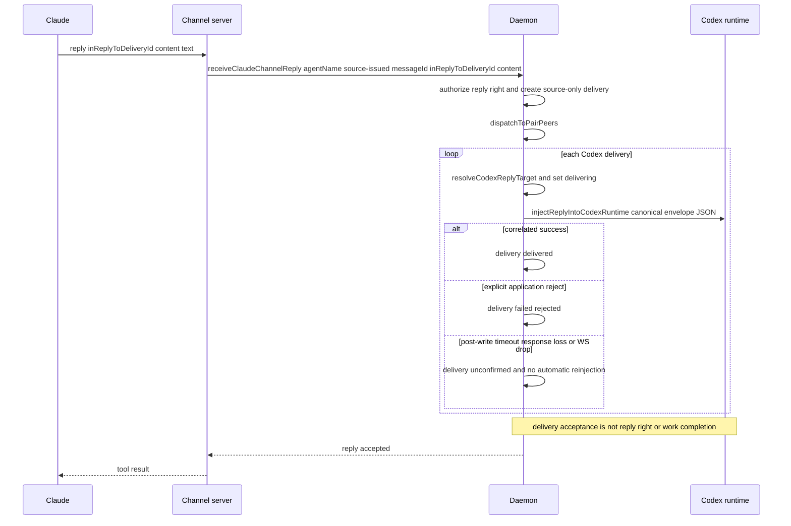

# aiox Local Runtime — Claude Adapter (§6)

Related:

- [[docs/architecture/local-agent-runtime]]
- [[docs/architecture/local-runtime-routing-and-delivery]]
- [[docs/architecture/local-runtime-codex-adapter]]
- [[docs/decisions/claude-channel-local-static-mcp-only]]
- [[docs/decisions/claude-channel-effective-registration-scope]]
- [[docs/decisions/claude-channel-session-reconnect-token]]
- [[docs/decisions/claude-channel-trust-and-registration]]

Status: Current

[[docs/architecture/local-agent-runtime]] is the compatibility index. This slice owns
the current/as-built Claude adapter topology, launch, channel registration, ingress
and injection flow.

## 6. Claude Adapter

### 6.1 Topology

Per Claude agent: 1 Claude CLI process + 1 channel-server stdio child
(spawned by Claude itself) + 1 loopback HTTP `/send` ingress on 127.0.0.1.

**Channel activation** ([[src/cli/invocation.ts]] — `src/cli/invocation.ts:148-216`):

Static MCP is the sole activation path:
`aiox claude setup --scope local|user|project` registers a static MCP
definition once (`claude mcp add-json <name> ... -s <scope>`, non-overwriting
— a name collision fails rather than being silently reused or replaced), then
`aiox claude --name <n>` activates it via `server:<name>`. A launch-time gate
(`requireClaudeMcpRegistration`) checks whether Claude resolves an effective
Local, User, or Project registration in the current cwd BEFORE any
daemon/attach/token side effect and fails fast if absent — never a silent
fallback. AIOX does not resolve scope precedence itself.
Session identity (agent name, token, daemon
socket path) flows only through the spawned `claude` process's env; the
registered definition's `${AIOX_*}` placeholders expand from it.
Related decision: [[docs/decisions/claude-channel-local-static-mcp-only]]
(supersedes the earlier plugin-strategy-default choice,
[[docs/decisions/claude-channel-plugin-default]], now historical).
The effective-registration rule is owned by
[[docs/decisions/claude-channel-effective-registration-scope]].

Channel-server is **not** a daemon child. The daemon only stores an
in-memory pointer (`claudeChannelRuntimes` Map at [[src/daemon/state.ts]]); no DB
row. Rationale: [[docs/decisions/claude-channel-trust-and-registration]] (DB-only + daemon memory registry).
The current session credential lifetime and replacement-child rebind rule are
owned by [[docs/decisions/claude-channel-session-reconnect-token]].

Evidence:

- Registration gate and activation
  - [[src/cli/invocation.ts]]
    - `src/cli/invocation.ts:148-216`
    - `src/cli/invocation.ts:282-342`
- Static MCP definition and launch command shape
  - [[src/adapters/claude/launcher.ts]]
    - `src/adapters/claude/launcher.ts:10-12`
    - `src/adapters/claude/launcher.ts:30-48`
    - `src/adapters/claude/launcher.ts:70-86`
- Daemon-side Claude channel registry
  - [[src/daemon/state.ts]]
    - `createDaemonState` channel-runtime maps

### 6.2 Launch Flow (`aiox claude --name <n>`)

1. Parser registers `--name` and `--pair`; the nested `claude setup` subcommand
   registers `--scope local|user|project` ([[src/cli/parse.ts]] —
   `src/cli/parse.ts:241-306`).
2. CLI checks the cwd-resolved effective Local, User, or Project MCP
   registration BEFORE any daemon/attach/token side effect; a missing
   registration fails fast with a coded error pointing to
   `aiox claude setup --scope <local|user|project>`
   ([[src/cli/invocation.ts]] — `src/cli/invocation.ts:148-154`,
   `src/cli/invocation.ts:320-342`).
3. CLI auto-starts daemon, calls `attachAgent({kind:"claude", name, ...})`.
4. Daemon mints a `randomUUID()` Claude channel token, stores it in
   `claudePendingTokens[agentName]`, and returns it as `claudeChannelToken`.
   The token remains valid for replacement channel-child registration until
   the top-level Claude session disconnects
   ([[src/daemon/state.ts]] — `attachAgent`, `registerClaudeChannel`,
   `disconnectClaudeChannel`; rationale:
   [[docs/decisions/claude-channel-session-reconnect-token]]).
5. CLI calls `launchClaudeStaticMcpChannel(...)` with the channel name,
   agent name/token, and daemon socket path
   ([[src/cli/invocation.ts]] — `src/cli/invocation.ts:191-217`). The launcher activates
   `--dangerously-load-development-channels server:aiox-claude-ingress` and
   injects identity only via the spawned process's env
   ([[src/adapters/claude/launcher.ts]] — `src/adapters/claude/launcher.ts:70-86`);
   the pre-registered static MCP definition's `${AIOX_CLAUDE_CHANNEL_AGENT_NAME}`
   / `${AIOX_CLAUDE_CHANNEL_TOKEN}` / `${AIOX_SOCKET_PATH}` placeholders expand
   from that env.
6. Claude spawns the channel-server stdio child by resolving the registered
   static MCP entry.
7. channel-server ([[src/adapters/claude/channel-server.ts]]):
   - `parseChannelServerEnv` fatal-exits if any required env is missing
     (`missing_env_*`, `channel-server.ts:668-676, 764-790`).
   - Creates an `McpServer` with capability `experimental: {"claude/channel":{}}`
     and `instructions: CLAUDE_CHANNEL_INSTRUCTIONS`
     (`channel-server.ts:309-321`).
   - Registers typed MCP tools `send(type, intent, replyExpected, content)`,
     `reply(inReplyToDeliveryId, intent, replyExpected, content)`, and the
     shared recovery tool
     `aiox_retransmit_unconfirmed_delivery(deliveryId, confirmDuplicateRisk)`
     (`channel-server.ts:323-366`).
   - Starts HTTP ingress on 127.0.0.1:0 (or
     `AIOX_CLAUDE_CHANNEL_PORT`, `channel-server.ts:560-607`). If an explicit
     port is already in use, it preserves the original typed
     `claude_channel_port_in_use` rejection while making a non-blocking,
     authenticated `reportClaudeChannelBootFailure` attempt with the session
     token (`channel-server.ts:585-597`, `:698-714`). Report failure does not
     replace or delay the original boot failure.
   - Calls `daemon.registerClaudeChannel({agentName, token, endpoint})`
     (`channel-server.ts:621-655`).
8. Daemon validates the session token and the endpoint
   (`parseLoopbackHttpEndpoint`: must be `http:` on loopback, path `/send`,
   non-empty port). On failure → `claude_channel_registration_failed` with
   `detail: "unknown_token"` or `"invalid_endpoint"` ([[src/daemon/state.ts]] —
   `registerClaudeChannel`). Channel-server
   `process.exit(1)` on registration failure ([[src/adapters/claude/channel-server.ts]] —
   `src/adapters/claude/channel-server.ts:621-655`).
   The boot-failure report uses the same pending session token, accepts only
   `claude_channel_port_in_use`, and records it only while no runtime is
   registered. A later successful registration clears the cause. Until then,
   a primary dispatch still returns the normalized deferred
   `target_runtime_unavailable` reason plus optional
   `cause: claude_channel_port_in_use`; raw port, error, message and stack are
   not retained ([[src/daemon/state.ts]] — `src/daemon/state.ts:1165-1185`,
   `src/daemon/state.ts:2062-2069`).
9. CLI awaits Claude exit then calls
   `disconnectClaudeChannel({agentName})` ([[src/cli/invocation.ts]] —
   `src/cli/invocation.ts:217`; [[src/daemon/state.ts]] —
   `disconnectClaudeChannel`), which removes the runtime, session token and
   boot cause and deletes the agent's row and its routes
   ([[docs/architecture/local-runtime-store-and-repositories]] —
   `agents.removeByName`/`routes.removeAllForAgent`). Unlike Codex, no
   `claude_channel_disconnected` event is appended — Implementation-only
   (no recorded rationale).
10. Three other Claude-credential-bearing exit paths also clear
    `claudePendingTokens` and `claudeChannelRuntimes` for the agent, alongside
    their existing Codex-map cleanup: attach-failure `rollbackAgentAttach`,
    the shared `detachCodexAgent` helper (used by both the `detachAgent` and
    `notifyTuiExited` daemon API methods, dispatched by method name only —
    not gated by agent kind), and `stop()`'s per-agent loop
    ([[src/daemon/state.ts]] — `rollbackAgentAttach`, `detachCodexAgent`,
    `stop`). `claudeChannelRuntimes` is the sole gate
    `injectMessageIntoClaudeTarget`/`retransmitClaudeUnconfirmedDelivery`
    check before pushing to a target's recorded HTTP endpoint (no
    `agent.status` check), so a stale entry surviving one of these paths
    would otherwise let the daemon keep pushing to a torn-down endpoint.

Evidence for the boot-failure boundary:

- Authenticated record/reject, runtime-ordering and cleanup behavior
  - [[tests/unit/daemon/api.test.ts]]
    - `tests/unit/daemon/api.test.ts:600-837`
- Real occupied-port report attempt preserves the original fatal
  - [[tests/unit/adapters/claude-channel.test.ts]]
    - `tests/unit/adapters/claude-channel.test.ts:1440-1510`

### 6.3 Claude → daemon Ingress (tool calls)

All three tool handlers (`channel-server.ts:371-473`, `:475-517`) create a
fresh `createDaemonSocketClient` per call and `close()` it `finally`.

- `send(type, intent, replyExpected, content)` →
  `daemon.receiveClaudeChannelMessage({agentName, messageId, ...})` → common
  send transaction → dispatch to Codex channels. (send transaction + delivery routing owned by
  [[docs/architecture/local-runtime-routing-and-delivery]]; Codex-side injection by
  [[docs/architecture/local-runtime-codex-adapter]].)
- `reply(inReplyToDeliveryId, intent, replyExpected, content)` →
  `daemon.receiveClaudeChannelReply({agentName, inReplyToDeliveryId, ...})` →
  `runReplyTransaction`, which authenticates the original target, consumes the
  one-time right, and creates a source-only reply. The stored
  `parentMessageId` is the originating delivery ID; it is not a separate
  authoring or authorization correlation contract.
- `aiox_retransmit_unconfirmed_delivery(deliveryId, confirmDuplicateRisk:true)` →
  `daemon.retransmitUnconfirmedDelivery({deliveryId, confirmDuplicateRisk})`
  (`channel-server.ts:475-517`). This is a separate operator-only recovery
  tool outside the `send`/`reply` pair, shared by name and schema with Codex
  ([[docs/architecture/local-runtime-codex-adapter]] §7.8); it requires an
  explicit `confirmDuplicateRisk:true` because a retransmit risks delivering a
  duplicate message. Unlike Codex's JSON-RPC-correlated retransmit, Claude's
  attempt resolves immediately from the same `injectClaudeChannel` fetch
  outcome used for a primary push: `delivered` on 2xx, a non-error
  `manual_retransmit_unconfirmed` structured result on ambiguous failure, or
  an MCP error result naming `manual_retransmit_rejected` /
   `manual_retransmit_failed`. There is no late-response resolution
  ([[src/daemon/state.ts]] — `src/daemon/state.ts:2175-2264`).
- Tool errors map to MCP `isError:true` results with `daemon_call_failed`
  or the propagated daemon `reason` string
  ([[src/adapters/claude/channel-server.ts]] — `src/adapters/claude/channel-server.ts:371-517`).

### 6.4 daemon → Claude Injection

`dispatchToPairPeers` ([[src/daemon/state.ts]] — `dispatchToPairPeers`; routing/FSM owner
[[docs/architecture/local-runtime-routing-and-delivery]]) is fired by both Codex and Claude
ingress paths. For each delivery whose target is a Claude agent:

1. Transition delivery to `delivering`.
2. Call `injectClaudeChannel(lookup, {agentName, content})`
   ([[src/adapters/claude/injector.ts]] — `src/adapters/claude/injector.ts:21-78`).
   `content` is the common canonical envelope JSON returned by the daemon
   formatter; Codex `turn/start` input and Claude HTTP `/send.content` receive
   the same bytes for a delivery. The Claude injector sends no AIOX-owned
   presentation metadata beside `content`.
3. Injector resolves the runtime; absent → `claude_channel_unavailable`.
   `fetch(endpoint, POST, body)` with `AbortController` 5 s timeout. Non-2xx →
   `claude_channel_push_failed`. AbortError/timeout and any other fetch error
   whose pre-write nature is not provable → `claude_channel_push_unconfirmed`,
   with no automatic retry. Only a positively identified `ECONNREFUSED`
   ([[src/adapters/claude/injector.ts]] — `src/adapters/claude/injector.ts:87-97`)
   → `claude_channel_unavailable`.
   When a primary daemon dispatch gets that confirmed refusal from the exact
   runtime instance it pushed to, daemon state applies the existing Claude
   disconnect effect, deleting the agent's row and its routes. It compares
   runtime identity after the asynchronous fetch so a same-name channel
   registered mid-flight is not cleared. Operator-triggered manual retransmit remains an
   attempt-local probe and does not mutate global connection state
   ([[src/daemon/state.ts]] — `src/daemon/state.ts:2072-2138`;
   [[tests/unit/daemon/api.test.ts]] — `tests/unit/daemon/api.test.ts:2080-2225`).
4. HTTP ingress validates the non-empty string `content`, passes it unchanged
   as `notifications/claude/channel.params.content`, and responds `202` ok /
   `400` parse error / `404` wrong method or path
   ([[src/adapters/claude/channel-server.ts]] —
   `src/adapters/claude/channel-server.ts:560-607`, `src/adapters/claude/channel-server.ts:733-751`).
   Claude Code, not AIOX, supplies the single outer `<channel source="…">`
   wrapper displayed in the TUI. That source identifies the channel server;
   the canonical JSON body's `source.address` identifies the sender.
   **Implementation-only (gap)**: The loopback HTTP
   `/send` endpoint is currently unauthenticated. This is a current factual limitation,
   not a security boundary (deferred to post-MVP).
5. On HTTP acceptance: the dispatcher records `delivered`. This is the same
   adapter/transport-acceptance boundary used by Codex, not target receipt or
   work completion: Codex observes a matching `turn/start` JSON-RPC success,
   while Claude observes the channel-server notification transport write. Claude
   Code does not acknowledge that notification; if the server was not loaded as
   a channel or policy blocks it, the downstream event can be silently dropped.
   On failure the dispatcher records the typed failure; an unavailable runtime
   is deferred/queued for the bounded pre-write policy. A primary
   `claude_channel_push_failed` transitions the original to `failed` and a
   primary `claude_channel_push_unconfirmed` leaves it `unconfirmed`; each
   independently authors a daemon-originated source outcome notification
   (`delivery_target_rejected` / `delivery_unconfirmed`) back to the original
   source, symmetric with the Codex-target producer
   ([[docs/architecture/local-runtime-codex-adapter]]) and governed by the
   same `(original delivery, outcome type)` dedupe
   ([[docs/specs/aiox-message-lifecycle]] §4.3;
   [[src/daemon/state.ts]] — `recordClaudeTargetRejectOutcome`,
   `recordPrimaryUnconfirmedOutcome`).

The channel server owns only the JSON-RPC notification shape; its
`buildChannelNotification` function creates `{method, params:{content}}`.
The MCP instructions make the host-wrapper/sender distinction explicit
([[src/adapters/claude/channel-server.ts]] —
`src/adapters/claude/channel-server.ts:40-49`, `src/adapters/claude/channel-server.ts:75-87`).
No `chat_id` or `origin` transport metadata exists on this path. Claude has no
Codex WebSocket `requestId` late-response or receipt-deduplication guarantee.

### 6.5 Sequence — Claude reply → daemon → Codex

