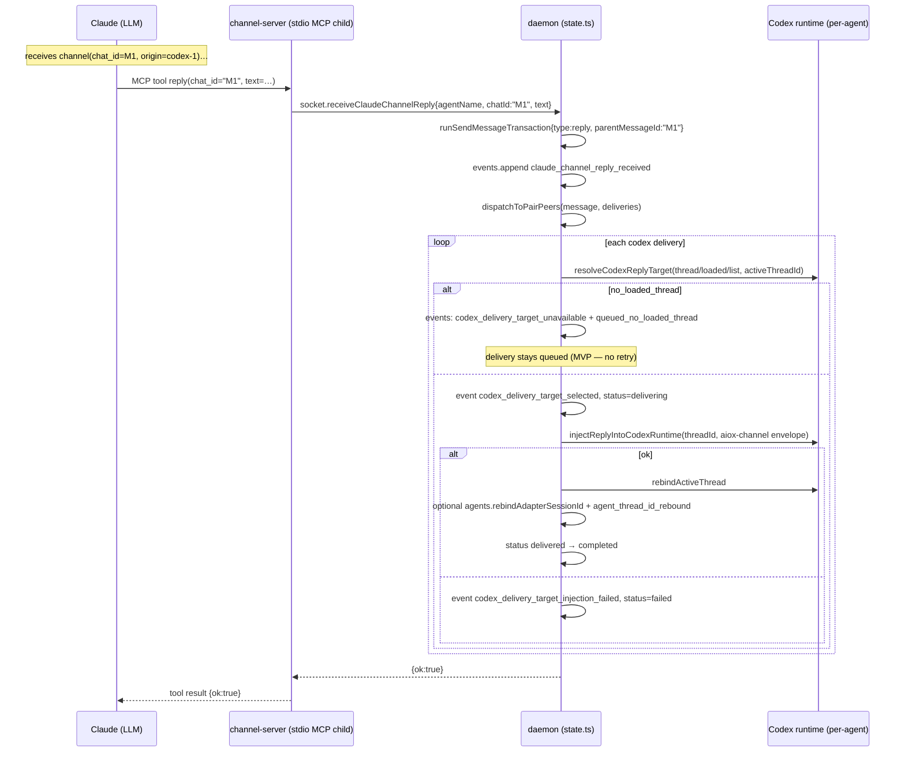

# aiox Local Runtime — Claude Adapter (§6)

Related:

- [[docs/architecture/local-agent-runtime]]
- [[docs/architecture/local-runtime-routing-and-delivery]]
- [[docs/architecture/local-runtime-codex-adapter]]
- [[docs/decisions/claude-channel-plugin-default]]
- [[docs/decisions/claude-channel-trust-and-registration]]

Status: Current

[[docs/architecture/local-agent-runtime]] is the compatibility index. This slice owns
the current/as-built Claude adapter topology, launch, channel registration, ingress
and injection flow.

## 6. Claude Adapter

### 6.1 Topology

Per Claude agent: 1 Claude CLI process + 1 channel-server stdio child
(spawned by Claude itself) + 1 loopback HTTP `/send` ingress on 127.0.0.1.

**Channel activation strategy** ([[src/cli/invocation.ts]] — `src/cli/invocation.ts:161-164, 219-248`):

- **Default (D — plugin strategy)**: `plugin:aiox-channel-ingress@aiox` activates
  the channel-server. `AIOX_CLAUDE_CHANNEL_STRATEGY` unset or `"plugin"`. Preflight
  validates plugin installation before attach.
  Related decision: [[docs/decisions/claude-channel-plugin-default]].
- **Legacy (A — inline strategy)**: `AIOX_CLAUDE_CHANNEL_STRATEGY=inline` only.
  Launcher injects `--mcp-config` with an inline aiox channel server definition
  (`buildClaudeChannelMcpConfig`). Dev/debug opt-out; no auto-fallback from D.

Channel-server is **not** a daemon child. The daemon only stores an
in-memory pointer (`claudeChannelRuntimes` Map at [[src/daemon/state.ts]] — `src/daemon/state.ts:521-522`); no DB
row. Rationale: [[docs/decisions/claude-channel-trust-and-registration]] (DB-only + daemon memory registry).

Evidence:

- Strategy resolution and default plugin path
  - [[src/cli/invocation.ts]]
    - `src/cli/invocation.ts:161-164`
    - `src/cli/invocation.ts:219-248`
    - `src/cli/invocation.ts:487-499`
- Plugin and inline launch command shapes
  - [[src/adapters/claude/launcher.ts]]
    - `src/adapters/claude/launcher.ts:19-27`
    - `src/adapters/claude/launcher.ts:94-118`
    - `src/adapters/claude/launcher.ts:132-161`
    - `src/adapters/claude/launcher.ts:189-208`
- Daemon-side Claude channel registry
  - [[src/daemon/state.ts]]
    - `src/daemon/state.ts:39-60`
    - `src/daemon/state.ts:521-524`

### 6.2 Launch Flow (`aiox claude --name <n>`)

1. Parser registers `--name` and `--pair`. `--resume` is option-scoped to
   the codex subcommand, so commander rejects `--resume` on `claude` at
   parse stage ([[src/cli/parse.ts]] — `src/cli/parse.ts:262-270`).
2. CLI auto-starts daemon, calls `attachAgent({kind:"claude", name, ...})`.
3. Daemon mints a `randomUUID()` claude channel token, stores it in
   `claudePendingTokens[agentName]`, returns it as `claudeChannelToken`
   ([[src/daemon/state.ts]] — `src/daemon/state.ts:610-617`).
4. CLI resolves channel strategy ([[src/cli/invocation.ts]] — `src/cli/invocation.ts:161-164`).
   - **Default — D plugin strategy** (`AIOX_CLAUDE_CHANNEL_STRATEGY` unset or `"plugin"`):
     Preflight checks plugin installation (`preflightStrategyDPlugin`). On pass,
     calls `launchClaudePluginChannel({pluginName:"aiox-channel-ingress", ...})`
     ([[src/cli/invocation.ts]] — `src/cli/invocation.ts:225-248`). Claude activates channel-server via the installed
     plugin `plugin:aiox-channel-ingress@aiox`; token and socket path flow via env
     vars that the plugin's `.mcp.json` expands.
   - **Legacy — A inline strategy** (`AIOX_CLAUDE_CHANNEL_STRATEGY=inline`, dev/debug only):
     Calls `launchClaudeWithChannel({channelName:"aiox-claude-ingress", agentName, agentToken, daemonSocketPath})`
     ([[src/adapters/claude/launcher.ts]]). The
     launcher appends `--mcp-config` with an inline channel-server definition
     (`buildClaudeChannelMcpConfig`, `launcher.ts:94-118`): `command` = node/tsx (execution-mode
     resolved), `args` = absolute `channel-server.js|ts`, `env` =
     `AIOX_CLAUDE_CHANNEL_AGENT_NAME` / `AIOX_CLAUDE_CHANNEL_TOKEN` /
     `AIOX_SOCKET_PATH`. No auto-fallback from D to A on D preflight failure
     ([[src/cli/invocation.ts]] — `src/cli/invocation.ts:461-479`).
5. Claude spawns the channel-server stdio child (via plugin resolution or injected
   `--mcp-config` depending on strategy).
6. channel-server ([[src/adapters/claude/channel-server.ts]] — `src/adapters/claude/channel-server.ts:549-581`):
   - `parseChannelServerEnv` fatal-exits if any required env is missing
     (`missing_env_*`, `channel-server.ts:538-547, 638-650`).
   - Creates an `McpServer` with capability `experimental: {"claude/channel":{}}`
     and `instructions: CLAUDE_CHANNEL_INSTRUCTIONS`
     (`channel-server.ts:258-305`).
   - Registers MCP tools `send(text)` and `reply(chat_id, text)`
     (`channel-server.ts:272-302`).
   - Starts HTTP ingress on 127.0.0.1:0 (or
     `AIOX_CLAUDE_CHANNEL_PORT`, `channel-server.ts:432-478`).
   - Calls `daemon.registerClaudeChannel({agentName, token, endpoint})`
     (`channel-server.ts:491-525`).
7. Daemon validates the pending token and the endpoint
   (`parseLoopbackHttpEndpoint`: must be `http:` on loopback, path `/send`,
   non-empty port). On failure → `claude_channel_registration_failed` with
   `detail: "unknown_token"` or `"invalid_endpoint"` ([[src/daemon/state.ts]] —
   `src/daemon/state.ts:926-953`, `src/daemon/state.ts:2071-2085`). Channel-server
   `process.exit(1)` on registration failure ([[src/adapters/claude/channel-server.ts]] —
   `src/adapters/claude/channel-server.ts:491-525`).
8. CLI awaits Claude exit then calls
   `disconnectClaudeChannel({agentName})` ([[src/cli/invocation.ts]] —
   `src/cli/invocation.ts:256-258`; [[src/daemon/state.ts]] —
   `src/daemon/state.ts:956-971`). Unlike Codex, no
   `claude_channel_disconnected` event is appended — Implementation-only
   (no recorded rationale).

### 6.3 Claude → daemon Ingress (tool calls)

Both `send` and `reply` tool handlers (`channel-server.ts:307-393`) create a
fresh `createDaemonSocketClient` per call and `close()` it `finally`.

- `send(text)` → `daemon.receiveClaudeChannelMessage({agentName, messageId, text})`
  → `runSendMessageTransaction({type:"question"})` → dispatch to
  Codex channels. (send transaction + delivery routing owned by
  [[docs/architecture/local-runtime-routing-and-delivery]]; Codex-side injection by
  [[docs/architecture/local-runtime-codex-adapter]].)
- `reply(chat_id, text)` →
  `daemon.receiveClaudeChannelReply({agentName, chatId, text})` →
  `runSendMessageTransaction({type:"reply", parentMessageId: chatId})`.
  **`chat_id` is persisted as `parent_message_id`** ([[src/daemon/state.ts]] —
  `src/daemon/state.ts:1008-1041`, `src/daemon/state.ts:1761-1856`;
  Step 14 provenance: `logs/workspace-reset/retained-provenance/2026-06-19-mvp-history-archive.md` §2.3).
- Tool errors map to MCP `isError:true` results with `daemon_call_failed`
  or the propagated daemon `reason` string
  ([[src/adapters/claude/channel-server.ts]] — `src/adapters/claude/channel-server.ts:307-393`).

### 6.4 daemon → Claude Injection

`dispatchToPairPeers` ([[src/daemon/state.ts]] — `src/daemon/state.ts:1246-1324`; routing/FSM owner
[[docs/architecture/local-runtime-routing-and-delivery]]) is fired by both Codex and Claude
ingress paths. For each delivery whose target is a Claude agent:

1. Transition delivery to `delivering`.
2. Call `injectClaudeChannel(lookup, {agentName, content, chatId: message.id, origin: sourceName})`
   ([[src/adapters/claude/injector.ts]] — `src/adapters/claude/injector.ts:21-78`).
   `chat_id` is the **aiox message id**, `origin` is the **source agent
   name** ([[src/daemon/state.ts]] — `src/daemon/state.ts:1359-1366`; Step 14 provenance:
   `logs/workspace-reset/retained-provenance/2026-06-19-mvp-history-archive.md` §2.3).
3. Injector resolves the runtime; absent → `claude_channel_unavailable`.
   `fetch(endpoint, POST, body)` with `AbortController` 5 s timeout.
   Non-2xx or timeout → `claude_channel_push_failed`. Other fetch error →
   `claude_channel_unavailable`.
4. HTTP ingress (`channel-server.ts:432-478`) validates with `InboundMessage`
   zod schema, builds `<channel source="aiox" chat_id="..." origin="...">…</channel>`
   envelope, and pushes via MCP notification
   (`notifications/claude/channel`). Responds `202` ok / `400` parse error /
   `404` wrong method or path. **Implementation-only (gap)**: The loopback HTTP
   `/send` endpoint is currently unauthenticated. This is a current factual limitation,
   not a security boundary (deferred to post-MVP).
5. On success: `delivered → completed`. On failure: `failed` with typed
   reason.

V1 trusted framing (WHY: [[docs/decisions/claude-channel-trust-and-registration]]) is enforced by
`buildChannelNotification` ([[src/adapters/claude/channel-server.ts]] —
`src/adapters/claude/channel-server.ts:49-69`) and the MCP `instructions` string
(`src/adapters/claude/channel-server.ts:95-216`), not by per-message confirmation.

### 6.5 Sequence — Claude reply → daemon → Codex

