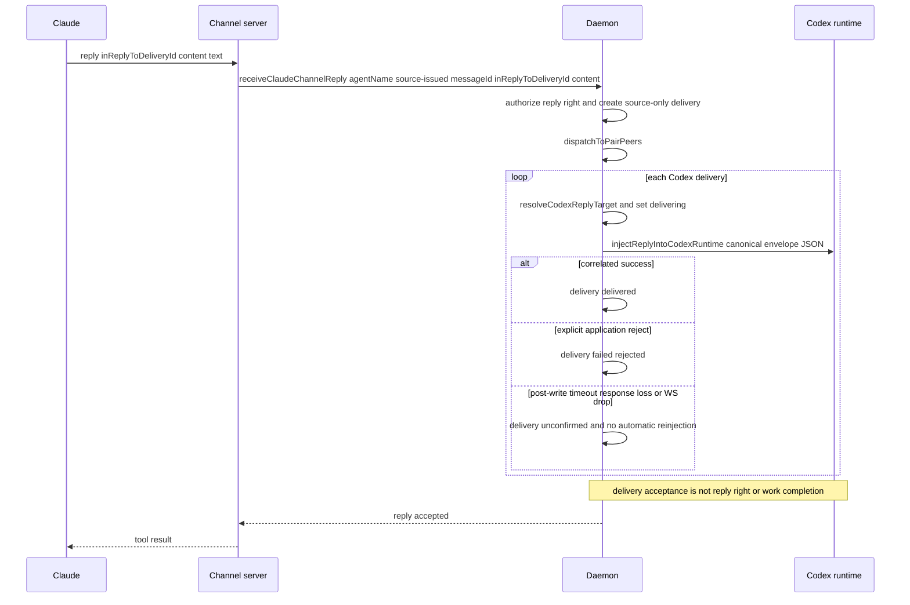

# aiox Local Runtime — Claude Adapter (§6)

Related:

- [[docs/architecture/local-agent-runtime]]
- [[docs/architecture/local-runtime-routing-and-delivery]]
- [[docs/architecture/local-runtime-codex-adapter]]
- [[docs/decisions/claude-channel-local-static-mcp-only]]
- [[docs/decisions/claude-channel-trust-and-registration]]

Status: Current

[[docs/architecture/local-agent-runtime]] is the compatibility index. This slice owns
the current/as-built Claude adapter topology, launch, channel registration, ingress
and injection flow.

## 6. Claude Adapter

### 6.1 Topology

Per Claude agent: 1 Claude CLI process + 1 channel-server stdio child
(spawned by Claude itself) + 1 loopback HTTP `/send` ingress on 127.0.0.1.

**Channel activation** ([[src/cli/invocation.ts]] — `src/cli/invocation.ts:148-216`):

Local static MCP is the sole activation path:
`aiox claude setup --scope local|user|project` registers a static MCP
definition once (`claude mcp add-json <name> ... -s <scope>`, non-overwriting
— a name collision fails rather than being silently reused or replaced), then
`aiox claude --name <n>` activates it via `server:<name>`. A launch-time gate
(`requireClaudeMcpLocalRegistration`) checks Local-scope registration BEFORE
any daemon/attach/token side effect and fails fast with a coded error if
absent — never a silent fallback. This gate and activation always target the
**Local** scope entry regardless of which scope `aiox claude setup` was run
with; attaching via a registered user/project entry is not implemented.
Session identity (agent name, token, daemon
socket path) flows only through the spawned `claude` process's env; the
registered definition's `${AIOX_*}` placeholders expand from it.
Related decision: [[docs/decisions/claude-channel-local-static-mcp-only]]
(supersedes the earlier plugin-strategy-default choice,
[[docs/decisions/claude-channel-plugin-default]], now historical).

Channel-server is **not** a daemon child. The daemon only stores an
in-memory pointer (`claudeChannelRuntimes` Map at [[src/daemon/state.ts]]); no DB
row. Rationale: [[docs/decisions/claude-channel-trust-and-registration]] (DB-only + daemon memory registry).

Evidence:

- Registration gate and activation
  - [[src/cli/invocation.ts]]
    - `src/cli/invocation.ts:148-216`
    - `src/cli/invocation.ts:282-342`
- Local static MCP definition and launch command shape
  - [[src/adapters/claude/launcher.ts]]
    - `src/adapters/claude/launcher.ts:10-12`
    - `src/adapters/claude/launcher.ts:30-48`
    - `src/adapters/claude/launcher.ts:70-86`
- Daemon-side Claude channel registry
  - [[src/daemon/state.ts]]
    - `createDaemonState` channel-runtime maps

### 6.2 Launch Flow (`aiox claude --name <n>`)

1. Parser registers `--name` and `--pair`; the nested `claude setup` subcommand
   registers `--scope local|user|project` ([[src/cli/parse.ts]] —
   `src/cli/parse.ts:241-306`).
2. CLI checks Local-scope MCP registration BEFORE any daemon/attach/token side
   effect; a missing registration fails fast with a coded error pointing to
   `aiox claude setup`
   ([[src/cli/invocation.ts]] — `src/cli/invocation.ts:148-154`,
   `src/cli/invocation.ts:320-342`).
3. CLI auto-starts daemon, calls `attachAgent({kind:"claude", name, ...})`.
4. Daemon mints a `randomUUID()` claude channel token, stores it in
   `claudePendingTokens[agentName]`, returns it as `claudeChannelToken`
   ([[src/daemon/state.ts]] — `attachAgent`).
5. CLI calls `launchClaudeStaticMcpChannel(...)` with the channel name,
   agent name/token, and daemon socket path
   ([[src/cli/invocation.ts]] — `src/cli/invocation.ts:191-217`). The launcher activates
   `--dangerously-load-development-channels server:aiox-claude-ingress` and
   injects identity only via the spawned process's env
   ([[src/adapters/claude/launcher.ts]] — `src/adapters/claude/launcher.ts:70-86`);
   the pre-registered static MCP definition's `${AIOX_CLAUDE_CHANNEL_AGENT_NAME}`
   / `${AIOX_CLAUDE_CHANNEL_TOKEN}` / `${AIOX_SOCKET_PATH}` placeholders expand
   from that env.
6. Claude spawns the channel-server stdio child by resolving the registered
   static MCP entry.
7. channel-server ([[src/adapters/claude/channel-server.ts]] — `src/adapters/claude/channel-server.ts:560-605`):
   - `parseChannelServerEnv` fatal-exits if any required env is missing
     (`missing_env_*`, `channel-server.ts:560-569, 642-653`).
   - Creates an `McpServer` with capability `experimental: {"claude/channel":{}}`
     and `instructions: CLAUDE_CHANNEL_INSTRUCTIONS`
     (`channel-server.ts:280-321`).
   - Registers typed MCP tools `send(type, intent, replyExpected, content)`
     and `reply(inReplyToDeliveryId, intent, replyExpected, content)`
     (`channel-server.ts:294-319`).
   - Starts HTTP ingress on 127.0.0.1:0 (or
     `AIOX_CLAUDE_CHANNEL_PORT`, `channel-server.ts:462-500`).
   - Calls `daemon.registerClaudeChannel({agentName, token, endpoint})`
     (`channel-server.ts:513-547`).
8. Daemon validates the pending token and the endpoint
   (`parseLoopbackHttpEndpoint`: must be `http:` on loopback, path `/send`,
   non-empty port). On failure → `claude_channel_registration_failed` with
   `detail: "unknown_token"` or `"invalid_endpoint"` ([[src/daemon/state.ts]] —
   `registerClaudeChannel`). Channel-server
   `process.exit(1)` on registration failure ([[src/adapters/claude/channel-server.ts]] —
   `src/adapters/claude/channel-server.ts:513-547`).
9. CLI awaits Claude exit then calls
   `disconnectClaudeChannel({agentName})` ([[src/cli/invocation.ts]] —
   `src/cli/invocation.ts:217`; [[src/daemon/state.ts]] —
   `disconnectClaudeChannel`). Unlike Codex, no
   `claude_channel_disconnected` event is appended — Implementation-only
   (no recorded rationale).

### 6.3 Claude → daemon Ingress (tool calls)

Both `send` and `reply` tool handlers (`channel-server.ts:307-393`) create a
fresh `createDaemonSocketClient` per call and `close()` it `finally`.

- `send(type, intent, replyExpected, content)` →
  `daemon.receiveClaudeChannelMessage({agentName, messageId, ...})` → common
  send transaction → dispatch to Codex channels. (send transaction + delivery routing owned by
  [[docs/architecture/local-runtime-routing-and-delivery]]; Codex-side injection by
  [[docs/architecture/local-runtime-codex-adapter]].)
- `reply(inReplyToDeliveryId, intent, replyExpected, content)` →
  `daemon.receiveClaudeChannelReply({agentName, inReplyToDeliveryId, ...})` →
  `runReplyTransaction`, which authenticates the original target, consumes the
  one-time right, and creates a source-only reply. The stored
  `parentMessageId` is the originating delivery ID; it is not a separate
  authoring or authorization correlation contract.
- Tool errors map to MCP `isError:true` results with `daemon_call_failed`
  or the propagated daemon `reason` string
  ([[src/adapters/claude/channel-server.ts]] — `src/adapters/claude/channel-server.ts:307-393`).

### 6.4 daemon → Claude Injection

`dispatchToPairPeers` ([[src/daemon/state.ts]] — `dispatchToPairPeers`; routing/FSM owner
[[docs/architecture/local-runtime-routing-and-delivery]]) is fired by both Codex and Claude
ingress paths. For each delivery whose target is a Claude agent:

1. Transition delivery to `delivering`.
2. Call `injectClaudeChannel(lookup, {agentName, content})`
   ([[src/adapters/claude/injector.ts]] — `src/adapters/claude/injector.ts:21-78`).
   `content` is the common canonical envelope JSON returned by the daemon
   formatter; Codex `turn/start` input and Claude HTTP `/send.content` receive
   the same bytes for a delivery. The Claude injector sends no AIOX-owned
   presentation metadata beside `content`.
3. Injector resolves the runtime; absent → `claude_channel_unavailable`.
   `fetch(endpoint, POST, body)` with `AbortController` 5 s timeout.
   Non-2xx or timeout → `claude_channel_push_failed`. Other fetch error →
   `claude_channel_unavailable`.
4. HTTP ingress validates the non-empty string `content`, passes it unchanged
   as `notifications/claude/channel.params.content`, and responds `202` ok /
   `400` parse error / `404` wrong method or path
   ([[src/adapters/claude/channel-server.ts]] —
   `src/adapters/claude/channel-server.ts:462-500`, `src/adapters/claude/channel-server.ts:611-629`).
   Claude Code, not AIOX, supplies the single outer `<channel source="…">`
   wrapper displayed in the TUI. That source identifies the channel server;
   the canonical JSON body's `source.address` identifies the sender.
   **Implementation-only (gap)**: The loopback HTTP
   `/send` endpoint is currently unauthenticated. This is a current factual limitation,
   not a security boundary (deferred to post-MVP).
5. On HTTP acceptance: the dispatcher records `delivered`. This is channel
   acceptance only, not target receipt or work completion. On failure it records
   the typed failure; an unavailable runtime is deferred/queued for the bounded
   pre-write policy.

The channel server owns only the JSON-RPC notification shape; its
`buildChannelNotification` function creates `{method, params:{content}}`.
The MCP instructions make the host-wrapper/sender distinction explicit
([[src/adapters/claude/channel-server.ts]] —
`src/adapters/claude/channel-server.ts:40-49`, `src/adapters/claude/channel-server.ts:75-87`).
No `chat_id` or `origin` transport metadata exists on this path. Claude has no
Codex WebSocket `requestId` late-response or receipt-deduplication guarantee.

### 6.5 Sequence — Claude reply → daemon → Codex

