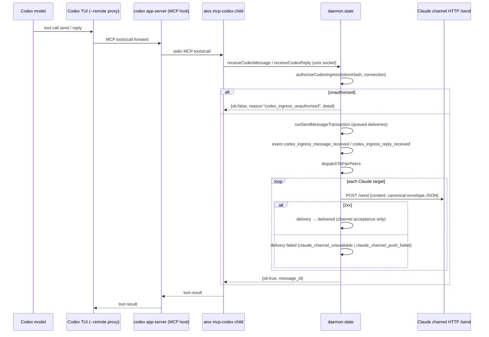

# aiox Local Runtime — Codex Adapter (§7)

Related:

- [[docs/architecture/local-agent-runtime]]
- [[docs/decisions/codex-per-agent-app-server]]
- [[docs/decisions/proxy-lazy-observation-cost-model]]
- [[docs/architecture/local-runtime-routing-and-delivery]]
- [[docs/decisions/pair-slot-generalization]]

Status: Current

This slice owns the current/as-built Codex adapter topology, attach/resume flow,
proxy binding, turn injection, MCP ingress, and lifecycle ownership.
[[docs/architecture/local-agent-runtime]] is the compatibility index and owns
status vocabulary, the module overview, and authority links.

## 7. Codex Adapter

This is the largest surface in the project.

### 7.1 Per-agent Runtime

Held in `CodexAgentRuntime` ([[src/adapters/codex/runtime.ts]] — `src/adapters/codex/runtime.ts:109-302`). Per
Codex agent: 1 daemon-owned app-server child + 1 daemon-owned per-agent
transparent proxy (in-process `WebSocketServer`) + 1 CLI-owned TUI child +
1 app-server-owned MCP child.

Daemon JSON-RPC writes go **directly** to the app-server (bypassing the
proxy) via the runtime's persistent WS client; the proxy URL is what the
TUI consumes ([[src/adapters/codex/runtime.ts]] — `src/adapters/codex/runtime.ts:136-148, 254-260`).

Evidence:

- Runtime endpoint and process ownership
  - [[src/adapters/codex/runtime.ts]]
    - `src/adapters/codex/runtime.ts:109-148`
    - `src/adapters/codex/runtime.ts:254-260`

Rationale: [[docs/decisions/codex-per-agent-app-server]] (per-agent app-server pivot, production direction).

### 7.2 Attach Flow (`aiox codex --name <n>`)

1. CLI parser registers `--name`, `--pair`, and codex-only `--resume`
   ([[src/cli/parse.ts]] — `src/cli/parse.ts:257-289`).
2. `agent-attach` auto-starts daemon, calls `attachAgent` RPC
   ([[src/cli/invocation.ts]] — `src/cli/invocation.ts:157-177`).
3. Daemon `attachAgent` ([[src/daemon/state.ts]] — `attachAgent`) wraps DB attach + pair attach
   + route creation in a single `withTransaction`. For Codex, it pre-issues
   `codexChannelToken = randomUUID()` and stores it in `codexPendingTokens`
   (`attachAgent`). Token is used by the MCP child handshake.
4. Daemon calls `attachCodexRuntime` (`attachAgent`) →
   `attachCodexAgentRuntime` (`runtime.ts:304-366`):
   a. `launchCodexAppServer` spawns `codex app-server --listen ws://127.0.0.1:0`
      plus injected `-c mcp_servers.aiox = {...}` args
      ([[src/adapters/codex/launcher.ts]] — `src/adapters/codex/launcher.ts:40-74, 88-104`).
   b. `parseCodexAppServerBanner` extracts URLs from stderr+stdout for
      `listening on:`, `readyz:`, `healthz:`. Endpoint must be `ws:` on
      loopback; readyz/healthz must be `http:`. Banner timeout 5 s
      ([[src/adapters/codex/app-server.ts]] — `src/adapters/codex/app-server.ts:90-120`; stderr-first endpoint collection — `docs/decisions/codex-per-agent-app-server.md` §2).
   c. `waitForCodexReadyz` polls every 200 ms up to 10 s, racing child-exit
      Promise (`app-server.ts:122-175`).
   d. `connectCodexAppServerWebSocket` opens persistent WS, 5 s connect
      timeout. Failure → typed `codex_app_server_ws_connect_failed`
      ([[src/adapters/codex/websocket.ts]] — `src/adapters/codex/websocket.ts:288-347`). **Current gap (P2-12):** WS transport is
      experimental/unsupported by upstream Codex. This is a current factual
      limitation of the adapter.
   e. `client.initialize()` sends JSON-RPC `initialize` with
      `{clientInfo:{name:"aiox",version:<package.version>}, capabilities: {experimentalApi:false}}`
      (`runtime.ts:402-413` reads package.json). Failure → typed
      `codex_app_server_ws_initialize_failed`.
   f. `startCodexAgentProxy` opens an in-process WS server on
      `127.0.0.1:0` whose upstream is the app-server endpoint
      ([[src/adapters/codex/proxy.ts]] — `src/adapters/codex/proxy.ts:58-149`, `runtime.ts:337-343`).
5. **Fresh attach skips daemon-side `thread/start`** (Step 14 follow-up,
   provenance logs/workspace-reset/retained-provenance/2026-06-19-mvp-history-archive.md §3.2). `adapter_session_id` stays null until explicit
   `--resume` or first live loaded-thread delivery.
6. Daemon returns `codexRuntime: { endpoint: proxy.url, activeThreadId: adapterSessionId }`
   (`attachAgent`).
7. CLI spawns TUI with `launchCodexTui({endpoint, resumeSessionId?})`
   ([[src/cli/invocation.ts]] — `src/cli/invocation.ts:178-185`; [[src/adapters/codex/launcher.ts]] — `src/adapters/codex/launcher.ts:76-86`):
   - Fresh: `codex --remote <proxy-url>`
   - Resume: `codex resume <session-id> --remote <proxy-url>`
   - Stdio `"inherit"` (TUI is CLI-child — [[docs/decisions/codex-per-agent-app-server]] §5).
8. CLI awaits TUI exit. On exit → `api.notifyTuiExited({agentName, exitCode, signal})`.
   On spawn error → `api.rollbackAgentAttach` then
   typed exit `aiox.invocation.tui_launch_failed`
   ([[src/cli/invocation.ts]] — `src/cli/invocation.ts:186-198`).

**Attach-failure cleanup ordering**:
WS connect / initialize failure unwinds in reverse — proxy → ws →
`disposeCodexAppServerOnAttachFailure(appServer)` (single SIGTERM, no
SIGKILL escalation, `app-server.ts:177-185`).

### 7.3 Resume Flow (`--resume <session-id>`)

Steps 1–4f are identical. Then:

- Daemon calls `runtime.resumeThread(sessionId)`
  (`attachAgent`, `runtime.ts:224-240`) → JSON-RPC `thread/resume {threadId}`
  and asserts returned id equals requested id. Mismatch or
  missing throws typed `codex_resume_failed`.
- `agents.rebindAdapterSessionId({...})` persists the new id
  (`attachAgent`).
- `agent_thread_id_rebound` event appended with `operation:"thread/resume", source:"attach_resume"`
  (`attachAgent`).
- CLI launches `codex resume <session-id> --remote <proxy-url>`.

Failure handling cleans up `startingCodexRuntime`, deletes pending token,
deletes the agent's row and its routes, returns the typed reason
(`attachAgent`, `defaultAttachCodexRuntime`).

### 7.4 Transparent Proxy

File `src/adapters/codex/proxy.ts`. WHY authority:
[[docs/decisions/proxy-lazy-observation-cost-model]] (lazy observation cost
model); transparent-relay spike and production reintroduction provenance in
`logs/workspace-reset/retained-provenance/2026-06-19-mvp-history-archive.md` §3.1, §1.

**Relay obligation**: every WebSocket frame, both directions, is relayed through
the proxy. Binary frames are preserved as-is; text frames are normalized to a
string before observation and relay ([[src/adapters/codex/proxy.ts]] —
`src/adapters/codex/proxy.ts:83-99, 225-239`). Frames received before upstream
`open` are queued (`proxy.ts:72, 76-91`).

**Observation rule** (binding methods: `thread/start`, `thread/resume`,
`thread/fork` — `proxy.ts:46-50`):

- Client→server: the proxy normalizes the frame, calls `observeClientFrame`,
  then sends or queues the frame according to upstream readiness. The observer
  records `{requestId → method}` in a per-connection `pendingBindings` Map
  before the relay branch (`proxy.ts:83-91, 151-166`).
- Server→client: `observeUpstreamFrame` consumes the matching entry on the
  response with the same `id` (`proxy.ts:168-194`). If `error` is present,
  no event fires. Otherwise extract `result.thread.id` and emit
  `CodexProxyBindingEvent{method, threadId, requestId}`.

**Lazy parse** (commit `edaf02b`; WHY: [[docs/decisions/proxy-lazy-observation-cost-model]]):
- Client side: `frameMayContainBindingMethod` does `indexOf` substring
  filter on the binding method names; binary frames return `false`
  (`proxy.ts:196-206`). Only survivors get `JSON.parse`d.
- Server side: early bail `if (pendingBindings.size === 0) return`
  (`proxy.ts:173-175`).
- A frame-size cutoff was considered but is **not** implemented; lazy parse
  relies solely on the substring filter
  ([[docs/decisions/proxy-lazy-observation-cost-model]], Alternatives) —
  Implementation-only refinement.

The runtime subscribes to proxy binding events via `runtime.onProxyBinding`
(`attachAgent`); the daemon-side handler `handleCodexProxyBinding`
rebinds `agents.adapterSessionId` in
`withTransaction` and appends `agent_thread_id_rebound` with
`operation:event.method, source:"proxy_binding"`.

### 7.5 Active-Thread Binding Authority

Three writer sources (in order):

1. **Daemon-originated `thread/resume`** during `--resume` attach
   (`attachAgent`).
2. **Proxy-observed same-connection response** for
   `thread/start|resume|fork` (`handleCodexProxyBinding`). Covers TUI-originated
   `/clear`, `/new`, `/fork`, and `/resume` when their JSON-RPC responses
   transit the proxy. Empty-thread `/fork` returns a JSON-RPC error so no
   rebind fires.
3. **Live `thread/loaded/list` fallback** at delivery time (see [[docs/architecture/local-runtime-routing-and-delivery]] §8.5).

The earlier internal TUI `/resume` wrong-thread risk was resolved for MVP by
same-connection proxy observation and covered by implementation smoke
(provenance: logs/workspace-reset/retained-provenance/2026-06-19-mvp-history-archive.md §3.2, §1). This depends on Codex continuing to send
`thread/resume` responses for TUI `/resume` through the same proxied
connection.

Event types: `agent_thread_id_rebound` (3 emission sites);
`codex_binding_uncertain_observed` is declared in the union but has **no
production emitter** ([[src/core/events.ts]] — `src/core/events.ts:15`; declared but never emitted —
planned at Step 10 but not landed at MVP closeout, Implementation-only).

### 7.6 Injection (`turn/start`)

File [[src/adapters/codex/injector.ts]]. A matching `turn/start` JSON-RPC
success, while the runtime's `activeThreadId` still equals the requested
`threadId`, is **delivery acceptance** only. It does **not** wait for
`turn/started` or `turn/completed`, and is neither target receipt nor work
completion. A timeout retains a same-socket request observer for five minutes;
a matching late success is returned to the daemon for an idempotent
`unconfirmed → delivered` resolution. Socket close or observer expiry only
cleans correlation state.

- Pre-request guard: thread mismatch → `codex_binding_uncertain`
  (`injector.ts:26-32`).
- Request body: `{threadId, input:[{type:"text", text:<envelope>}]}` —
  Codex 0.132.0 schema requires array form (upstream constraint).
- Post-ack guard: re-checks mismatch (`injector.ts:52-58`).
- Error mapping: typed codes, JSON-RPC code, and request id pass through;
  unknown errors become `adapter_inject_failed`. Post-write timeout/response
  loss/WS drop is handled by the daemon as `unconfirmed`, never as automatic
  retry.

The daemon-side wrapper `injectReplyIntoCodexRuntime`
(`injectReplyIntoCodexRuntime`) constructs a fresh `CodexTurnStartRuntime` view
with the freshly-resolved live thread id so the mismatch guard remains
meaningful without mutating the runtime cache pre-success.

### 7.7 Daemon → Codex Delivery (live loaded-thread + queued fallback)

Entry: `dispatchToPairPeers` (`src/daemon/state.ts` function `dispatchToPairPeers`; routing/FSM owner [[docs/architecture/local-runtime-routing-and-delivery]]).

1. `resolveCodexReplyTarget` (`src/daemon/state.ts` function `resolveCodexReplyTarget`):
   - Runtime absent / not ready → `codex_channel_unavailable`.
   - `runtime.listLoadedThreadIds()` → `thread/loaded/list` JSON-RPC.
   - **Selection policy**:
     - If `runtime.activeThreadId` is set → policy
       `"proxy_active_thread"`.
     - Empty → `codex_no_loaded_thread`. (The previous `loadedThreadIds.at(-1)`
       fallback was disabled in Step 15 D1 to prevent wrong-thread injection
       in same-vendor codex pairs — [[docs/decisions/pair-slot-generalization]]).
2. **No loaded thread**: emit `codex_delivery_target_unavailable` +
   `codex_delivery_queued_no_loaded_thread`. Delivery **stays queued**
   and returns `deferred` with reason `target_binding_unconfirmed` (no
   FSM transition). Conclusive pre-write failures use the bounded 250 ms / 1 s
   / 4 s retry policy, and queued work flushes when attach, resume/rebind, or
   proxy binding makes a target usable; neither is durable restart replay or
   passive target acknowledgement.
3. **Live target**: emit `codex_delivery_target_selected`, transition
   `queued → delivering`, and call `injectReplyIntoCodexRuntime` with the
   per-delivery canonical envelope JSON.
4. On matching JSON-RPC success: rebind the active thread when needed and
   transition to `delivered`. Timeout, response loss, or WS drop after the
   request write transitions to `unconfirmed`; a matching late success resolves
   only that delivery to `delivered`. There is no automatic reinjection.
5. On a matching explicit JSON-RPC reject: transition the original delivery to
   `failed`, persist exactly one daemon-originated outcome notification for its
   source, and dispatch it after the transaction commits. A manual retransmit
   reject is attempt-local and preserves the original `unconfirmed` delivery.

### 7.8 Codex MCP Ingress (Codex → daemon)

File [[src/adapters/codex/mcp-server.ts]]. The Step 13 ingress provenance is
preserved in `logs/workspace-reset/retained-provenance/2026-06-19-mvp-history-archive.md` §2.4; current behavior is
owned here.

**Tools**: Codex and Claude expose the same public messaging tool names.
- `send({type, intent, replyExpected, content})` → daemon `receiveCodexMessage`.
- `reply({inReplyToDeliveryId, intent, replyExpected, content})` → daemon
  `receiveCodexReply`.
- `aiox_retransmit_unconfirmed_delivery({deliveryId, confirmDuplicateRisk:true})`
  is a separate operator direct attempt outside the common `send`/`reply`
  contract. Claude provides the same named recovery tool and schema; neither
  adapter queues a manual retransmit.
- `agents_list()` takes no input and returns only the calling agent's current
  outbound-sendable peers. It is a read-only peer-catalog tool, not a messaging
  tool.

These are current typed tools, not pre-G1 compatibility signatures. They map
the daemon lifecycle request/result defined by [[docs/specs/aiox-message-lifecycle]]
§4.1–§4.4. Codex `requestId` is internal JSON-RPC late/duplicate-response
correlation: it is not emitted in source-facing MCP results or canonical
envelopes. Tier 3 has no automatic control-plane ack or completed producer.

**Launcher injection** (`launcher.ts`):
`-c mcp_servers.aiox = { command=<process.execPath>, args=[<aioxBin>, "mcp-codex"], env_vars=["AIOX_CODEX_AGENT_NAME", "AIOX_CODEX_AGENT_TOKEN", "AIOX_SOCKET_PATH"] }`. The launcher passes the three actual values only in the daemon-owned app-server's process environment; the inline configuration and argv contain names, not credential values. This is injected into the **daemon-owned app-server**, not
into the foreground TUI. The Step 14 correction is preserved in
`logs/workspace-reset/retained-provenance/2026-06-19-mvp-history-archive.md` §2.3: earlier Step 13 injected into
the TUI, which in `--remote` mode is not the MCP host, so the aiox MCP never
registered.

**Token handshake**:
1. Daemon pre-issues `codexChannelToken = randomUUID()` and stores it in
   `codexPendingTokens` (`attachAgent`).
2. Token + agent name + socket path are env-passed through to the MCP
   child.
3. MCP child does `mcp.connect()` first, then `registerCodexChannel`
   (Step 14 correction provenance: `logs/workspace-reset/retained-provenance/2026-06-19-mvp-history-archive.md`
   §2.3).
4. Daemon consumes the pending token, stores `tokenHash = sha256(token)`
   in `codexChannelRuntimes` (full SHA-256, not 12-char
   prefix — Step 13 ingress provenance: `logs/workspace-reset/retained-provenance/2026-06-19-mvp-history-archive.md`
   §2.4), appends `codex_channel_registered`.
5. `send` and `reply` call `authorizeCodexIngress`, which checks token
   presence, agent registration, connection status, and token hash equality.
   Reasons: `codex_ingress_unauthorized` with
   `detail ∈ {missing_token, agent_not_registered, agent_disconnected, token_mismatch}`.
   `agents_list` is the accepted exception: it is read-only, derives its caller
   name from launcher-injected process state rather than tool input, and makes
   the local daemon-socket peer-catalog read without a token.

### 7.9 Lifecycle and Ownership

**Ownership model** (WHY: [[docs/decisions/codex-per-agent-app-server]] §5; memory
`aiox-codex-attach-ownership`): `attachAgent` is the Codex runtime
lifecycle owner. The daemon is the only owner of the app-server child; the
daemon owns same-client JSON-RPC authority; the CLI is the sole parent of
the TUI child. Claude attach is DB-only.

**Dispose ordering** (`runtime.dispose()`, `runtime.ts:193-209`):
1. `webSocket.close()`
2. Best-effort fire-and-forget `closeProxyBestEffort` (proxy close runs
   before SIGTERM yields the event loop — Implementation-only ordering
   note at `runtime.ts:204-205`).
3. `await disposeAppServer(appServer)` → SIGTERM → 3 s grace → SIGKILL
   (`app-server.ts:187-219`).

**Listen-only observers** (`runtime.ts:264-286`):
- `appServer.child.exit` → `recordRuntimeFailure({type:"app_server_process_exited"})`
- `webSocket.onClose` → `recordRuntimeFailure({type:"ws_dropped"})`
- `webSocket.onNotification` for `remoteControl/status/changed` →
  stored as `latestDiagnosticNotification` (D7 — diagnostic context only, not
  binding authority; provenance logs/workspace-reset/retained-provenance/2026-06-19-mvp-history-archive.md §2.2).

**Current gap (P2-3):** Runtime-failure callback flows up to
`recordCodexRuntimeFailed` (`createDaemonState`), appending
`agent_runtime_failed`, but is **not wired** in production.
`defaultAttachCodexRuntime` does not pass
`onRuntimeFailed`, meaning the app-server dying does not properly
disconnect the agent in MVP.

### 7.10 Sequence — Codex MCP → daemon → Claude

