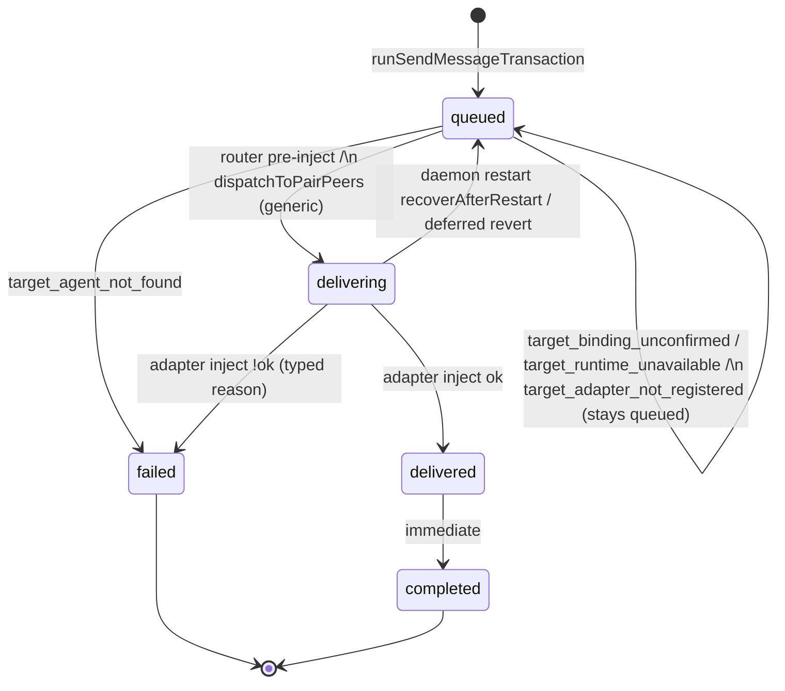
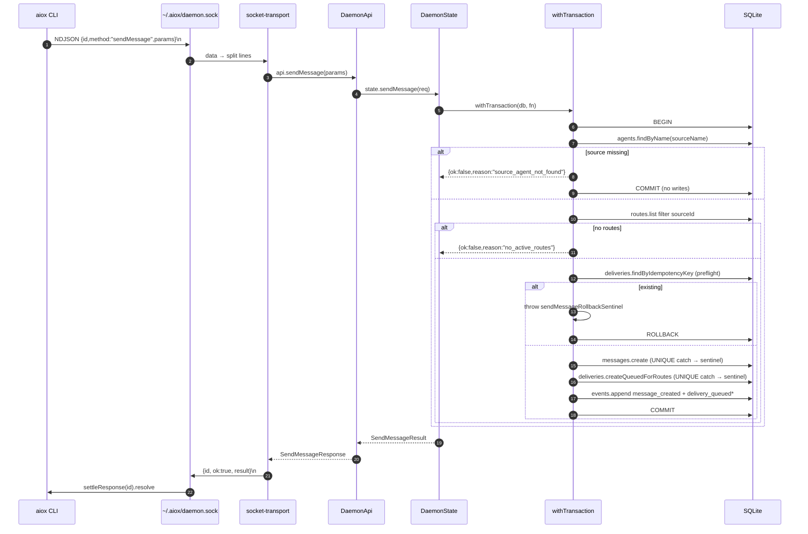

# aiox Local Runtime — Cross-Cutting Message Routing and Delivery (§8, §4.3)

> 컨텍스트: [[local-agent-runtime]] 인덱스. status 어휘·module overview·authority links는 인덱스가 소유한다.
>
> §4.3 sendMessage end-to-end sequence는 원본에서 §4 daemon transport 아래 있었으나 routing/FSM
> 소유라 이 slice가 가진다. daemon lifecycle/transport/API는 [[local-runtime-daemon-transport-api]].

## 8. Cross-Cutting Message Routing

### 8.1 Domain Model

- **Message**: [[src/core/messages.ts]] — `src/core/messages.ts:17-23`; type ∈
  `question|instruction|status|event|reply`.
- **Delivery**: [[src/core/deliveries.ts]] — `src/core/deliveries.ts:13-19`. Idempotency key formatted
  `${messageId}:${targetAgentId}` (line 34). Status ∈
  `queued|delivering|delivered|completed|failed` (lines 3-9).
- **Pair**: [[src/core/pairs.ts]]. Reaches `ready` when both slots (`a` and
  `b`) are filled (`attachments.length === 2 && slots.has("a") && slots.has("b")`
  — `pairs.ts:107-117`). Slot assignment is auto-selected at attach time; no
  vendor is hardwired to a specific slot.
- **Route**: directed `(source, target)`. Fan-out filters
  `sourceAgentId === source.id`.

### 8.2 sendMessage Atomicity + Idempotency

`runSendMessageTransaction` ([[src/daemon/state.ts]] — `src/daemon/state.ts:1761-1864`) is wrapped in a single
`withTransaction`. Sequence:

1. `agents.findByName(sourceName)` → `source_agent_not_found`.
2. `routes.list().filter(sourceId)` → empty → `no_active_routes` (β-1
   atomic reject). **No** message/delivery/event
   rows are written on this path.
3. Idempotency preflight: `deliveries.findByIdempotencyKey` per route. Hit
   → throw `sendMessageRollbackSentinel` carrying
   `{reason:"delivery_idempotency_key_exists", existing}` (preflight runs
   inside the tx; rollback via the sentinel pattern —
   [[pair-attach-atomicity-and-sentinel]]).
4. `createMessageOrRollback` and `deliveries.createQueuedForRoutes` —
   `SQLITE_CONSTRAINT_UNIQUE` is caught and reclassified through the same
   sentinel (dual gate).
5. Append `message_created` event + one `delivery_queued` per delivery.
6. Outer catch unwraps the sentinel via `isSendMessageRollback`; anything
   else rethrows.

The CLI `send` surface (OA1) is **deferred Post-MVP** (provenance: logs/2026-06-19-mvp-history-archive.md §4.1).
Confirmed by absence of any `send` subcommand in [[src/cli/parse.ts]].
Messages enter only via the four daemon-internal RPCs
(`receiveClaudeChannelMessage`, `receiveClaudeChannelReply`,
`receiveCodexMessage`, `receiveCodexReply`).

### 8.3 Router and Fan-out

`createAdapterRouter` ([[src/adapters/router.ts]] — `src/adapters/router.ts:39-124`):
1. Call `api.sendMessage(outgoing)`. Propagate `{ok:false}` as-is.
2. Snapshot `api.status()` to look up target agents by id.
3. **Sequential** `for (const delivery of fanout.deliveries)`. Sequential
   chosen for MVP because inject waits only for `turn/start` acceptance
   (WHY: [[codex-per-agent-app-server]] §4 — inject waits only for
   `turn/start` acceptance). Per-target ack-timeout absolute value is deferred
   (Post-MVP).
4. Per-target partial-failure isolation:
   - `target_agent_not_found` → delivery `failed`, continue.
   - Missing target adapter (`target_adapter_not_registered`) → returned as `deferred` and delivery remains `queued`, continue (`src/adapters/router.ts:87-97`, verified by [[tests/unit/adapters/fake-integration.test.ts]] — `tests/unit/adapters/fake-integration.test.ts:437`).
   - Successful inject → `delivering` → `delivered` → `completed`.
   - Failed inject → `failed` carrying the typed reason.

Note: routing inside `dispatchToPairPeers` does **not** go through this
router — it directly calls the per-adapter inject path and manages delivery
transitions inline. Production dispatch remains `dispatchToPairPeers`, with target-kind branching; adapter registry/router refactor is Deferred (D6 registry — [[pair-slot-generalization]]). The router lives parallel for now and is exercised mainly by adapter integration tests (`tests/unit/adapters/fake-integration.test.ts`).

### 8.4 Delivery State Machine

Each transition appends `delivery_status_changed` via helper `updateDeliveryStatusInTransaction` (`src/daemon/state.ts:1192-1244`).
Transitions are driven by:
- Daemon RPC `updateDeliveryStatus` (`src/daemon/state.ts:828-830`)
- Daemon internal `dispatchToPairPeers` (`state.ts:1246-1324`)
- Per-adapter internal `injectMessageIntoClaudeTarget` (`state.ts:1354`; detail [[local-runtime-claude-adapter]] §6.4) or `injectMessageIntoCodexTarget` (`state.ts:1496`; detail [[local-runtime-codex-adapter]] §7.7)

### 8.5 `parent_message_id`

**Implemented.** Persisted column ([[src/store/repositories/messages.ts]] (L27, L58, L66, L98)),
created by `messages.create({...,parentMessageId})` (repo:46), surfaced on
`MessageDto.parentMessageId` ([[src/daemon/api.ts]] — `src/daemon/api.ts:115`).

Wired on both sides:
- Claude reply path: MCP `reply.chat_id` → daemon `chatId` → message
  `parentMessageId` via `receiveClaudeChannelReply` (`src/daemon/state.ts:1010-1016`).
- Codex reply path: MCP `aiox_reply.parent_message_id` → daemon
  `parentMessageId` → message `parentMessageId` via `receiveCodexReply`
  (`src/daemon/state.ts:1132-1138`, MCP handler parameter mapping in
  [[src/adapters/codex/mcp-server.ts]] — `src/adapters/codex/mcp-server.ts:223` and `L243`).

Cross-agent reply correlation (`parent_message_id`) semantics were finalized at
Step 13; the provenance is preserved in
`logs/2026-06-19-mvp-history-archive.md` §2.4.
The router/FSM do not consume `parentMessageId` —
it is purely correlative data on the persisted message and the
`<aiox-channel message_id="...">` envelope.

### 8.6 Pair Reservation + Routes

Pair attach is X-strict (WHY: [[pair-attach-atomicity-and-sentinel]]): `agents.attach` accepts no
`pairId`; pair association happens separately via `pairs.attachAgent`
which enforces three checks in its own `db.transaction`: agent exists,
kind matches, slot not occupied by another agent. Failures
`pair_slot_occupied` / `pair_full` / `agent_kind_mismatch` are thrown out
of the outer `withTransaction` via `attachRollbackSentinel`.
(`pair_kind_slot_occupied` was superseded in Step 15 D3; `pair_slot_occupied`
and `pair_full` are now the canonical reason codes — `src/core/pairs.ts:39,44`.)

When the pair becomes `ready`, `createBidirectionalPairRoutes`
(`state.ts:2099-2135`) creates bidirectional routes between `slotA` and `slotB`, supporting both same-vendor and mixed-vendor configurations dynamically. Each is skipped if already present (bidirectional, silent idempotent, no audit event).

Directed routes via `aiox connect <source> <target>...` go through
`state.connect` (`state.ts:723-763`). Duplicates land in `alreadyExisted`.

---

## 4.3 sendMessage end-to-end (sequence)

원본에서 이 sequence는 §4 Daemon Lifecycle and Socket Transport 아래 있었으나, routing/FSM이
실제 소유하는 흐름(`src/daemon/state.ts:1761-1864`)이라 이 routing slice가 가진다.

