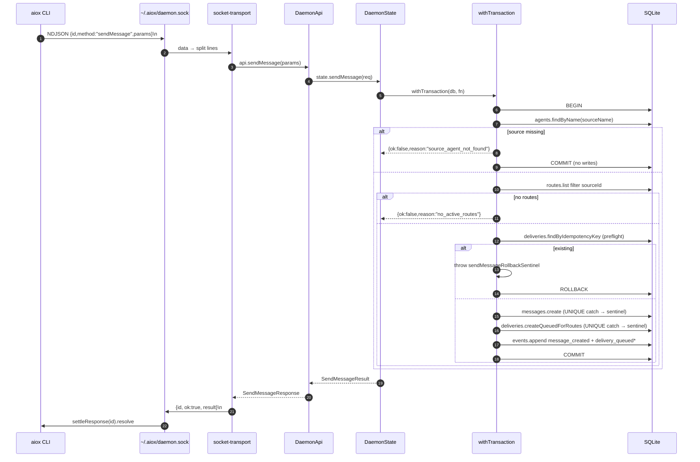

# aiox Local Runtime — Cross-Cutting Message Routing and Delivery (§8, §4.3)

Related: [[docs/architecture/local-agent-runtime]], [[docs/architecture/local-runtime-daemon-transport-api]], [[docs/decisions/pair-attach-atomicity-and-sentinel]], [[docs/decisions/codex-per-agent-app-server]], [[docs/decisions/pair-slot-generalization]], [[docs/architecture/local-runtime-claude-adapter]], [[docs/architecture/local-runtime-codex-adapter]]
Status: Current

This slice owns cross-cutting routing and delivery state machine behavior. The
`local-agent-runtime` index owns status vocabulary, module overview, authority
links, and the document map; daemon lifecycle/transport/API remain in the
daemon transport/API slice.

§4.3 sendMessage end-to-end sequence was originally under §4 daemon transport,
but the sequence is routing/FSM-owned, so this slice owns it.

## 8. Cross-Cutting Message Routing

### 8.1 Domain Model

- **Message**: [[src/core/messages.ts]] — `src/core/messages.ts:17-23`; type ∈
  `question|instruction|event|reply`.
- **Delivery**: [[src/core/deliveries.ts]] — `src/core/deliveries.ts:3-12`. Idempotency key formatted
  `${messageId}:${targetAgentId}` (`src/core/deliveries.ts:34`). Status ∈
  `queued|delivering|delivered|completed|failed|unconfirmed`. `unconfirmed`
  is post-write acceptance ambiguity, not a synonym for `delivered`.
- **Identifier boundary**: `idempotencyKey` is the common daemon/store
  delivery-creation guard (`messageId:targetAgentId`, DB UNIQUE) before either
  adapter. `deliveryId` is the target-specific public ID. Codex `requestId`
  is only internal JSON-RPC late/duplicate-response correlation. Claude does
  not claim an equivalent receipt/requestId dedupe guarantee.
- **Public-ID issuer boundary**: source adapters call the common public-ID
  factory for agent-authored send/reply `messageId` values. The daemon calls
  that factory for daemon-originated outcome `messageId` values and every
  `deliveryId`; each `deliveryId` remains the immutable
  `message_deliveries.id` row primary key. Shared internal `createId` issues
  entity/event IDs only and is not a public-ID issuer. Consumers compare public
  IDs for equality and do not parse their prefix, UUID/encoding, issuer, or
  ordering. See [[docs/specs/aiox-message-lifecycle]] §4.1.
- **Pair**: [[src/core/pairs.ts]]. Reaches `ready` when both slots (`a` and
  `b`) are filled (`attachments.length === 2 && slots.has("a") && slots.has("b")`
  — `src/core/pairs.ts:107-117`). Slot assignment is auto-selected at attach time; no
  vendor is hardwired to a specific slot.
- **Route**: directed `(source, target)`. Fan-out filters
  `sourceAgentId === source.id`.

### 8.2 sendMessage Atomicity + Idempotency

`runSendMessageTransaction` ([[src/daemon/state.ts]] — `runSendMessageTransaction`) is wrapped in a single
`withTransaction`. Sequence:

1. `agents.findByName(sourceName)` → `source_agent_not_found`.
2. `routes.list().filter(sourceId)` → empty → `no_active_routes` (β-1
   atomic reject). **No** message/delivery/event
   rows are written on this path.
3. Idempotency preflight: `deliveries.findByIdempotencyKey` per route. Hit
   → throw `sendMessageRollbackSentinel` carrying
   `{reason:"delivery_idempotency_key_exists", existing}` (preflight runs
   inside the tx; rollback via the sentinel pattern —
   [[docs/decisions/pair-attach-atomicity-and-sentinel]]).
4. `createMessageOrRollback` and `deliveries.createQueuedForRoutes` —
   `SQLITE_CONSTRAINT_UNIQUE` is caught and reclassified through the same
   sentinel (dual gate).
5. Append `message_created` event + one `delivery_queued` per delivery.
6. Outer catch unwraps the sentinel via `isSendMessageRollback`; anything
   else rethrows.

Evidence:

- Transaction and rollback paths
  - [[src/daemon/state.ts]]
    - `runSendMessageTransaction`

The CLI `send` surface (OA1) is **deferred Post-MVP** (provenance:
`logs/workspace-reset/retained-provenance/2026-06-19-mvp-history-archive.md` §4.1). Confirmed by absence of any
`send` subcommand in [[src/cli/parse.ts]].
Messages enter only via the four daemon-internal RPCs
(`receiveClaudeChannelMessage`, `receiveClaudeChannelReply`,
`receiveCodexMessage`, `receiveCodexReply`).

Evidence:

- CLI surfaces and daemon-internal ingress
  - [[src/cli/parse.ts]]
    - `src/cli/parse.ts:214-220`
    - `src/cli/parse.ts:291-313`
  - [[src/daemon/state.ts]]
    - `receiveClaudeChannelMessage`, `receiveClaudeChannelReply`
    - `receiveCodexMessage`, `receiveCodexReply`

### 8.3 Router and Fan-out

`createAdapterRouter` ([[src/adapters/router.ts]] — `src/adapters/router.ts:39-124`):
1. Call `api.sendMessage(outgoing)`. Propagate `{ok:false}` as-is.
2. Snapshot `api.status()` to look up target agents by id.
3. **Sequential** `for (const delivery of fanout.deliveries)`. Sequential
   chosen for MVP because inject waits only for `turn/start` acceptance
   (WHY: [[docs/decisions/codex-per-agent-app-server]] §4 — inject waits only for
   `turn/start` acceptance). Per-target ack-timeout absolute value is deferred
   (Post-MVP).
4. Per-target partial-failure isolation:
   - `target_agent_not_found` → delivery `failed`, continue.
   - Missing target adapter (`target_adapter_not_registered`) → returned as `deferred` and delivery remains `queued`, continue (`src/adapters/router.ts:87-97`, verified by [[tests/unit/adapters/fake-integration.test.ts]] — `tests/unit/adapters/fake-integration.test.ts:437-485`).
   - Successful inject → `delivering` → `delivered` (target acceptance only).
   - Failed inject → `failed` carrying the typed reason.

Note: routing inside `dispatchToPairPeers` does **not** go through this
router — it directly calls the per-adapter inject path and manages delivery
transitions inline. Production dispatch remains `dispatchToPairPeers`, with target-kind branching; adapter registry/router refactor is Deferred (D6 registry — [[docs/decisions/pair-slot-generalization]]). The router lives parallel for now and is exercised mainly by adapter integration tests (`tests/unit/adapters/fake-integration.test.ts`).

Evidence:

- Router behavior and test coverage
  - [[src/adapters/router.ts]]
    - `src/adapters/router.ts:47-155`
  - [[tests/unit/adapters/fake-integration.test.ts]]
    - `tests/unit/adapters/fake-integration.test.ts:437-485`
    - `tests/unit/adapters/fake-integration.test.ts:488-540`
- Production dispatch path
  - [[src/daemon/state.ts]]
    - `dispatchToPairPeers`, `dispatchToPairPeersNow`
    - `injectMessageIntoClaudeTarget`, `injectMessageIntoCodexTarget`

### 8.4 Delivery State Machine

```mermaid
stateDiagram-v2
    [*] --> queued: runSendMessageTransaction
    queued --> delivering: router pre-inject /\n dispatchToPairPeers (generic)
    queued --> queued: pre-inject deferred /\n target_binding_unconfirmed / target_runtime_unavailable /\n target_adapter_not_registered
    queued --> failed: target_agent_not_found
    queued --> failed: TTL expiry / delivery_expired
    delivering --> delivered: matching acceptance response
    delivering --> unconfirmed: post-write timeout / response loss / WS drop
    unconfirmed --> delivered: matching late success
    delivering --> failed: matching explicit reject
    unconfirmed --> failed: primary late explicit reject
    unconfirmed --> unconfirmed: manual timeout/drop or late reject; original remains unconfirmed
    delivering --> queued: conclusively pre-write retry / deferred
    failed --> [*]
```

Each persisted status transition appends `delivery_status_changed` via helper
`updateDeliveryStatusInTransaction`. Some deferred paths remain `queued`
without first writing `delivering`. Only conclusively pre-write failures enter
bounded retry/queued flush; `unconfirmed` never re-enters queue or reconnect
flush automatically.

The as-built pre-write policy uses retry delays of 250 ms, 1 s, and 4 s
(maximum three retries), target queue capacity 32, and queued TTL 5 minutes.
Those timers are in-memory current Tier 3 behavior, not a durable
process-restart promise. `completed` is retained in the enum for the committed
Phase 1 Tier 2 automatic-ack uplift; it has no current producer.
Transitions are driven by:
- Daemon RPC `updateDeliveryStatus`
- Daemon internal `dispatchToPairPeers`
- Per-adapter internal `injectMessageIntoClaudeTarget` (detail [[docs/architecture/local-runtime-claude-adapter]] §6.4) or `injectMessageIntoCodexTarget` (detail [[docs/architecture/local-runtime-codex-adapter]] §7.7)
- Late-response and outcome handling in `injectMessageIntoCodexTarget`
  (`injectMessageIntoCodexTarget`)

Evidence:

- Deferred queued behavior
  - [[src/daemon/state.ts]]
    - `dispatchToPairPeers`, `dispatchToPairPeersNow`
    - `injectMessageIntoClaudeTarget`, `injectMessageIntoCodexTarget`
  - [[tests/unit/daemon/codex-ingress.test.ts]]
    - `tests/unit/daemon/codex-ingress.test.ts:509-538`
    - `tests/unit/daemon/codex-ingress.test.ts:1229-1256`

### 8.5 Delivery and reply correlation

The public `deliveryId` is the target-specific `message_deliveries.id` and the
canonical envelope is rendered per delivery. Correlated replies use
`inReplyToDeliveryId`, a persisted one-reply right, authenticated source
identity, and source-only reply creation; `parentMessageId` remains storage
provenance, not the reply-authorization authority. Daemon-originated rejection
notifications are distinct messages with `outcomeForDeliveryId`: they do not
reuse `inReplyToDeliveryId`, grant no reply right, and have their own delivery.
The state transaction makes an original explicit reject, its event, and its
single notification relation atomic; dispatch follows commit.

Primary and manual late rejects are intentionally different. A primary
correlated reject may change the original from `delivering` or `unconfirmed`
to `failed` and emits `delivery_target_rejected` plus its source outcome.
A manual-retransmit reject emits only attempt-local
`delivery_manual_retransmit_rejected`; the original remains `unconfirmed`.

### 8.6 Pair Reservation + Routes

Pair attach is X-strict (WHY: [[docs/decisions/pair-attach-atomicity-and-sentinel]]): `agents.attach` accepts no
`pairId`; pair association happens separately via `pairs.attachAgent`
which enforces three checks in its own `db.transaction`: agent exists,
kind matches, slot not occupied by another agent. Failures
`pair_slot_occupied` / `pair_full` / `agent_kind_mismatch` are thrown out
of the outer `withTransaction` via `attachRollbackSentinel`.
(`pair_kind_slot_occupied` was superseded in Step 15 D3; `pair_slot_occupied`
and `pair_full` are now the canonical reason codes — `src/core/pairs.ts:39,44`.)

When the pair becomes `ready`, `createBidirectionalPairRoutes`
(`createBidirectionalPairRoutes`) creates bidirectional routes between `slotA` and `slotB`, supporting both same-vendor and mixed-vendor configurations dynamically. Each is skipped if already present (bidirectional, silent idempotent, no audit event).

Directed routes via `aiox connect <source> <target>...` go through
`state.connect` (`connect`). Duplicates land in `alreadyExisted`.

Evidence:

- Pair reservation and route creation
  - [[src/store/repositories/pairs.ts]]
    - `src/store/repositories/pairs.ts:76-191`
  - [[src/daemon/state.ts]]
    - `attachAgent`, `connect`, `createBidirectionalPairRoutes`

---

## 4.3 sendMessage end-to-end (sequence)

원본에서 이 sequence는 §4 Daemon Lifecycle and Socket Transport 아래 있었으나, routing/FSM이
실제 소유하는 흐름(`runSendMessageTransaction`)이라 이 routing slice가 가진다.

