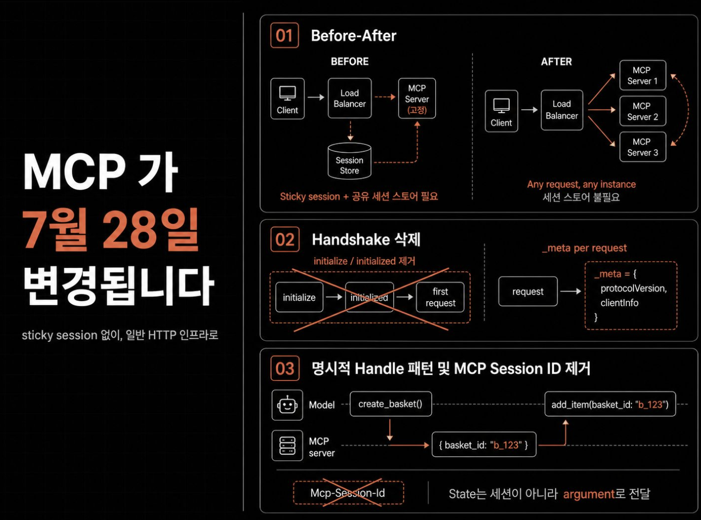

https://www.linkedin.com/posts/jyoung105_mcp-%ED%94%84%EB%A1%9C%ED%86%A0%EC%BD%9C%EC%9D%B4-7%EC%9B%94-28%EC%9D%BC%EC%97%90-%EC%99%84%EC%A0%84%ED%9E%88-%EB%B0%94%EB%80%9D%EB%8B%88%EB%8B%A4-release-candidate-share-7465178125644238848-m7Lx/?utm_source=social_share_send&utm_medium=ios_app&rcm=ACoAAEvyYy0BdAN4y30cdCZnsUw99Wxq8uUSi5A&utm_campaign=share_via

```text
MCP 프로토콜이 7월 28일에 완전히 바뀝니다

Release Candidate: https://lnkd.in/gKUQesDN

소프트웨어가 헤드리스 구조로 나아가는 과정에서 가장 중요한 개념은 MCP 입니다. ChatGPT, Claude 등에 연결하여 사용하는 Connector 가 해당 MCP 구조를 요구하기 때문입니다.

하지만 MCP 서버를 원격(remote)으로 운영해본 분은 아실 겁니다.
보통 sticky session 걸고 session store 공유하고 load balancer 설정까지 건드려야 합니다.

하지만 7월 28일부터 이 구조가 전부 바뀝니다.
프로토콜 자체가 stateless 로 전환돼요.

소프트웨어 업계 사람에게 매우 중요한 이야기입니다.
달라지는 점을 8가지로 정리했습니다.

① initialize/initialized handshake 가 삭제됩니다

프로토콜 버전과 client info 는 이제 매 요청 _meta 에 담겨서 갑니다.
서버 capabilities 가 필요하면 server/discover 를 호출하면 돼요.
기존에는 initialize → initialized 두 단계를 거쳐야 첫 요청을 보낼 수 있었는데 이 과정 자체가 없어집니다.

② Mcp-Session-Id 도 사라집니다

세션 ID 가 없으니 요청이 어떤 서버 인스턴스에 떨어져도 처리 가능합니다.
sticky session 과 session store 가 필요 없어져요.
round-robin load balancer 하나면 충분합니다.

③ 상태가 필요하면 explicit handle 패턴을 사용하세요

프로토콜 세션이 사라졌다고 stateful 앱을 못 만드는 건 아닙니다.
서버가 basket_id 같은 handle 을 발급하고 모델이 다음 호출에 argument 로 넘기면 돼요.
오히려 모델이 handle 을 tool 간에 넘겨가며 추론할 수 있어서 세션 기반보다 유연합니다.

④ server-to-client 요청 방식이 달라집니다

기존에는 SSE 스트림을 열어두고 서버가 클라이언트에 요청을 보냈습니다.
이제는 서버가 InputRequiredResult 를 반환하고 클라이언트가 inputResponses 와 requestState 를 담아 재요청하는 구조예요.
모든 상태가 payload 안에 있으니 어떤 인스턴스가 받아도 처리됩니다.

⑤ Mcp-Method 와 Mcp-Name 이 필수 헤더입니다

load balancer 나 gateway 가 body 를 열지 않고도 라우팅할 수 있게 됩니다.
거기에 ttlMs 와 cacheScope 가 추가돼서 tools/list 같은 응답 캐싱도 가능해졌어요.
W3C Trace Context 전파도 스펙에 정식 포함됩니다.

⑥ Extensions 가 독립 프레임워크로 올라갑니다

extension 마다 reverse-DNS ID 를 부여하고 코어 프로토콜 버전과 독립적으로 버저닝합니다.
공식 extension 으로 MCP Apps(서버 렌더링 UI) 와 Tasks(비동기 장시간 작업) 가 포함돼요.
특히 Tasks 는 2025-11-25 실험 버전에서 lifecycle 이 완전히 재설계됐으니 반드시 기존 구현에 대해 마이그레이션이 필요합니다.

⑦ Roots, Sampling, Logging 은 deprecated 대상입니다

Roots 는 tool parameter 나 resource URI 로 대체하고 Sampling 은 LLM provider API 를 직접 연동하는 방식이 됩니다.
Logging 은 stdio 에서는 stderr, 나머지는 OpenTelemetry 로 전환이에요.
당장 삭제는 아니고 최소 12개월 유예 기간이 있습니다.

⑧ 인증 스펙이 OAuth/OIDC 기준으로 강화됩니다

인증 응답에서 iss 파라미터 검증이 필수가 돼요.
Dynamic Client Registration 시 application_type 선언도 추가됩니다.
데스크톱이나 CLI 클라이언트가 web 으로 기본 분류돼서 localhost redirect 가 거부되던 문제도 해결됩니다.

⚠️ 이번 발표는 다소 과격한 변동 사항이 포함됩니다

Release candidate 는 5월 21일에 잠겼고 최종 스펙은 7월 28일에 나옵니다. Tier 1 SDK 는 10주 안에 지원 구현이 필요해요.
에러 코드도 -32002 에서 JSON-RPC 표준 -32602 로 바뀌니 literal matching 하는 코드가 있으면 미리 수정해두세요.

소프트웨어가 점점 headless 구조로 가고 있고 AI 가 외부 도구와 통신하는 표준인 MCP 의 중요성은 더욱 높아질 것입니다.

그런 점에서 이번 stateless 전환은 단순한 스펙 업데이트가 아니라 MCP 를 일반 HTTP 인프라 위에서 돌릴 수 있게 만드는 전환점이에요.
그래서 7월 28일 전에 한번 훑어두면 좋겠습니다.

꼭 필요한 AI 정보를 지속적으로 업로드하고 있습니다.
저와 "1촌"이 되면 유용한 정보를 놓치지 않을 거에요.
```



---

## 검토 기록 — 우리 프로젝트(ai-orchestration) 영향 (2026-07-19, @claude)

위 LinkedIn 글(2차 출처)이 우리 프로젝트에 영향을 미치는지, 코드베이스 대조와 공식
스펙 대조 두 단계로 검토한 결과를 남긴다. **확인한 사실 / 추론 / 제안**을 구분한다.

### 1. 글 신뢰도 — 공식 1차 소스로 검증 (확인한 사실)

- 글의 8개 항목 + 부수 주장을 공식 소스로 대조: **확인 11 / 부분일치 1 / 틀림 0.** 날조·중대
  오류 없음. 글은 2026-07-28 RC changelog를 기술적으로 정확하게 요약했다.
- 시점: 글의 "7월 28일"은 **2026-07-28**(오늘 2026-07-19 기준 미래). RC lock은 2026-05-21.
  글의 미래형 서술은 시점상 정확하다.
- 유일한 부정확(경미): ⑥ "Tasks가 2025-11-25에 lifecycle 재설계"는 부정확 — 2025-11-25는
  Tasks **도입** 시점이고, extension 재설계는 이번 RC(SEP-2663). 방향은 맞다.
- 중요 스코프 조건(글이 가린 부분): 대형 변경(②세션·③handle·④MRTR/SSE·⑤헤더/캐싱·⑧OAuth)은
  공식 changelog가 전부 **"Streamable HTTP transport 한정"**으로 명시한다. 프로토콜 전체가
  stateless로 바뀌는 게 아니라 remote/HTTP transport 운영 표면의 변경이다.

### 2. 우리 프로젝트 영향 — 사실상 없음 (확인한 사실)

- 우리 MCP 표면은 **로컬 stdio 서버 전용**이다. MCP 서버 2개(`src/adapters/codex/mcp-server.ts`,
  `src/adapters/claude/channel-server.ts`)가 모두 `StdioServerTransport`만 쓰고,
  `StreamableHTTP`/`SSEServerTransport`는 src에 0건이다. capabilities는 tools만 선언
  (sampling/roots/logging 미사용). MCP 로깅은 이미 stderr로 나간다.
- 따라서 transport 층 변경(②③④⑤⑧)은 우리를 비껴가고, core 변경도 무해하다:
  ①핸드셰이크는 SDK `McpServer`가 처리(우리 코드에 리터럴 의존 없음) → SDK 업그레이드로 흡수,
  ⑦Roots/Sampling/Logging deprecated는 셋 다 미사용(logging은 이미 공식 권장 stderr와 일치),
  에러코드 -32002→-32602는 우리 src가 리터럴 매칭하지 않음, ⑥MCP Apps/Tasks 미사용.
- 참고(혼동 방지): `websocket.ts`의 `initialize()`/session id는 **Codex app-server 자체
  JSON-RPC**이지 MCP가 아니며, `Mcp-Session-Id`와 무관하다.

### 3. 잔여 리스크와 조건부 트리거 (추론)

- 실질(작은) 리스크는 프로토콜 wire 변경이 아니라, 우리가 의존하는
  `@modelcontextprotocol/*` **2.0.0-alpha.2 SDK를 RC/GA로 올릴 때의 breaking change**다.
  이는 SDK 마이그레이션 이슈이고, Codex adapter가 이미 Tier 3 + app-server WS upstream
  미지원이라 **G0/G1 cutover 전 재검증 posture**에 포함돼 있어 별도 긴급 트랙은 불필요하다.
- 조건부 재소환 트리거: 만약 향후 `docs/specs/aiox-federation-remote.md` §8의 exploratory
  L2(aiox MCP surface를 HTTP로 원격 노출)를 실제 착수하면, 그때 비로소 ②(세션)·⑤(헤더/캐싱)·
  ⑧(OAuth/OIDC)이 관련된다. 현재는 코드 없는 Deferred 상태다.

### 4. 제안 (의견)

- **현재 조치 불필요.** 코드 변경·호환 코드·마이그레이션 모두 불필요하며, pre-v1·외부
  consumer 없음·삭제 기본 원칙과 정합한다. legacy/compat 선제 추가는 하지 않는다.
- owner 문서(spec/architecture/decision)는 바꾸지 않는다 — 이 검토는 no-impact 결론이라
  권위 내용을 바꾸지 않는다. 이 기록은 재조사 방지와 조건부 트리거 보존 목적이다.

### Sources

- 공식 blog: https://blog.modelcontextprotocol.io/posts/2026-07-28-release-candidate/
- 공식 changelog(draft): https://modelcontextprotocol.io/specification/draft/changelog
- 근거 SEP: `modelcontextprotocol/modelcontextprotocol` PR #2575·#2567·#2322·#2243·#2549·#414·#2663·#2577·#2596·#2468·#837
- 코드 근거: `src/adapters/codex/mcp-server.ts`, `src/adapters/claude/channel-server.ts`,
  `package.json`(SDK 2.0.0-alpha.2), `docs/architecture/local-runtime-codex-adapter.md` §7.8,
  `docs/specs/aiox-adapter-model.md`(Tier 3), `docs/specs/aiox-federation-remote.md` §8
